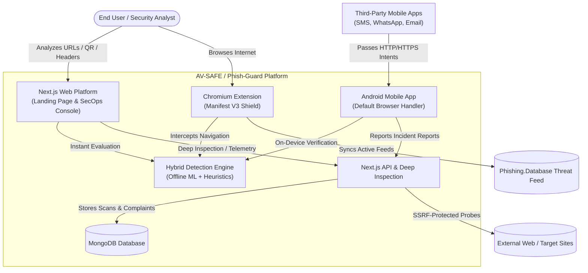
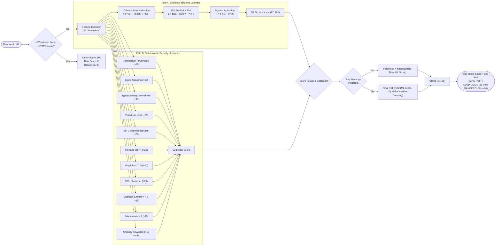
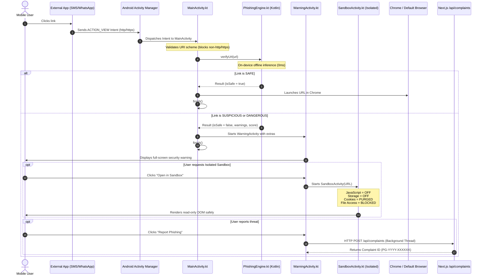
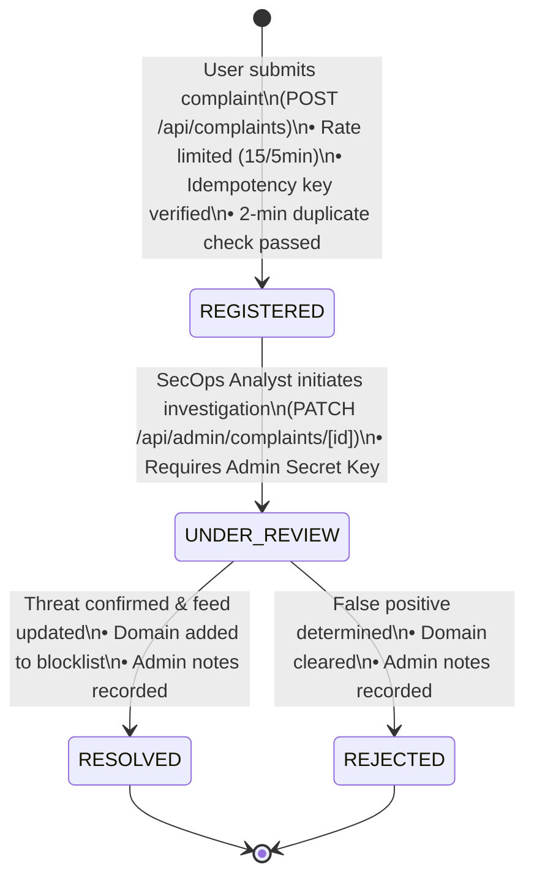
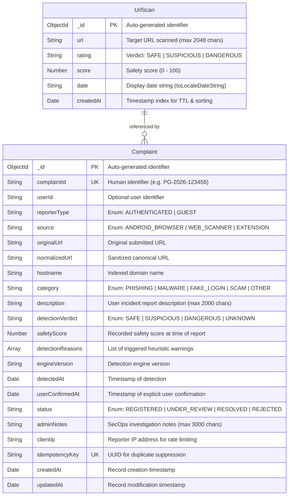

# System Architecture Report: Phish-Guard (AV-SAFE / SecureOS Threat Shield)

## 1. Executive Summary & System Overview

**Phish-Guard** (internally designated **AV-SAFE / SecureOS Threat Shield**) is an explainable, multi-platform cybersecurity platform engineered to detect, intercept, analyze, and mitigate phishing threats and malicious web infrastructure in real time.

Unlike black-box scanners that emit opaque risk scores without justification, Phish-Guard couples a **transparent Machine Learning classifier** (trained on 24 structural, statistical, and linguistic URL features derived from the benchmark PhiUSIIL dataset) with a **deterministic Heuristic Security Layer** (covering homograph attacks, typosquatting, brand spoofing, entropy metrics, and TLD abuse). 

The platform is designed around **zero-latency edge enforcement** and **defense-in-depth**:
* **3 Native Client Enforcement Targets**: Full-Stack Web Application (PWA), Native Android Browser Interceptor, and Chromium Extension.
* **Unified Offline Detection Core**: Cross-compiled detection algorithms and identical model weights operational in Node.js, V8 extension runtime, and native Android ART.
* **Active Deep Network Inspection**: Server-side asynchronous DNS resolution, TLS certificate validation, and DOM inspection protected by strict anti-SSRF guards.
* **Incident Triage & Threat Intelligence**: Centralized MongoDB persistence with idempotent user complaint submission, rate-limiting, and SecOps review workflow.

---

## 2. System Context & C4 Architecture Decomposition

To provide an exhaustive blueprint for architecture diagrams, the system is modeled below across **Level 1 (System Context)**, **Level 2 (Containers)**, and **Level 3 (Component & Data Flows)**.

### Level 1: System Context Diagram



---

## 3. Container & Component Architecture (Level 2 & Level 3)

The project consists of 5 primary subsystems:

```mermaid
flowchart TD
    %% SUB-SYSTEM 1: WEB FRONTEND & APIS
    subgraph SubsystemWeb["Subsystem 1: Next.js 16 Web Platform (App Router)"]
        LandingPage["Landing Page (src/app/page.js)\n• Hero quick scan\n• APK distribution link\n• Interactive FAQ"]
        ConsolePage["SecOps Console (src/app/system/page.js)\n• 9 Modular Security Tabs\n• Responsive Dashboard Shell"]
        
        subgraph WebTabs["Console Tabs (src/app/components/)"]
            TabOverview["OverviewTab\n(Live Telemetry & Quick Scan)"]
            TabUrl["UrlCheckerTab\n(Deep Scan, Breakdown & Tags)"]
            TabEmail["EmailAnalyzerTab\n(SPF/DKIM/DMARC Parser)"]
            TabAnalytics["AnalyticsTab\n(Recharts Visualizations)"]
            TabQR["QrScannerTab / QrScanner.js\n(HTML5-QRCode Camera Scanner)"]
            TabComplaints["ComplaintsTab\n(User Lookup & Admin Review)"]
            TabHistory["HistoryTab\n(MongoDB Scan Log Table)"]
            TabGuide["SecurityGuideTab\n(Threat Education Knowledge Base)"]
            TabSettings["SettingsTab\n(API Keys & Preferences)"]
            ModalSandbox["SafeSandboxModal.js\n(Simulated Isolated Preview)"]
        end
        
        subgraph WebAPIs["API Route Handlers (src/app/api/)"]
            RouteAnalyze["POST /api/analyze\n(Deep Network Scanner)"]
            RouteHistory["GET/POST/DELETE /api/history\n(Scan Log Persistence)"]
            RouteComplaints["GET/POST /api/complaints\n(Idempotent Incident Reports)"]
            RouteAdminComplaints["GET/PATCH /api/admin/complaints\n(SecOps Incident Management)"]
        end
        
        PwaWorker["PWA Service Worker\n(public/sw.js & PwaRegister.js)\nCache-first static, network-first pages"]
    end

    %% SUB-SYSTEM 2: DETECTION ENGINE
    subgraph SubsystemEngine["Subsystem 2: Hybrid Detection Core (Cross-Platform)"]
        EngineJS["JavaScript Core (src/lib/phishingEngine.js)"]
        EngineWeights[("Weights & Scaling\n(src/lib/phishing_model_weights.json)\n24 Features, Means, Stds, Weights, Bias")]
        EngineKotlin["Kotlin Native Port\n(android-app/.../PhishingEngine.kt)"]
        EngineExtension["Extension Engine\n(extansion/phishingEngine.js\n+ Active Feed Set Check)"]
    end

    %% SUB-SYSTEM 3: ANDROID CLIENT
    subgraph SubsystemAndroid["Subsystem 3: Android Native Mobile App (android-app/)"]
        AndroidMain["MainActivity.kt\n• android.intent.action.VIEW filter\n• Google Play Services Code Scanner\n• Intent scheme gatekeeper"]
        AndroidWarning["WarningActivity.kt\n• High-risk interstitial warning\n• Threat reason breakdown\n• Incident reporting dialog trigger"]
        AndroidSandbox["SandboxActivity.kt\n• Hardened isolated WebView\n• JS/DOM storage disabled\n• Cookie wipe & file:// blocked"]
        AndroidClient["ComplaintApiClient.kt\n• Background worker thread\n• Retrofit/HttpURLConnection to /api/complaints"]
    end

    %% SUB-SYSTEM 4: BROWSER EXTENSION
    subgraph SubsystemExt["Subsystem 4: Chromium Extension (extansion/)"]
        ExtManifest["manifest.json (Manifest V3)\nPermissions: webNavigation, storage, tabs"]
        ExtBackground["background.js (Service Worker)\n• chrome.webNavigation.onBeforeNavigate\n• In-memory 15,000 domain Set()\n• Threat feed background sync"]
        ExtPopup["popup.html / popup.js\n• Instant URL risk evaluator\n• Active toggle & sync status"]
        ExtWarning["warning.html / warning.js\n• Blocking splash redirect"]
        ExtSandbox["sandbox.html / sandbox.js\n• Isolated frame preview"]
    end

    %% SUB-SYSTEM 5: ML & DATA
    subgraph SubsystemData["Subsystem 5: ML Training Pipeline & Data Layer"]
        ScriptTrain["scripts/train_merged_model.py\n• Downloads PhishTank, URLhaus, Tranco\n• Trains SGD / Logistic Regression\n• Patches JSON & Kotlin files"]
        ScriptDownload["scripts/download_dataset.py\n(Kagglehub PhiUSIIL dataset)"]
        ScriptQR["scripts/generate_qr.py\n(Generates simulated test QR)"]
        ModelMongoose["Mongoose Schemas (src/lib/models/)\n• UrlScan.js (Scan history)\n• Complaint.js (Incident reports)"]
        DatabaseEngine[("MongoDB Database Cluster")]
    end

    %% Connectors
    LandingPage --> ConsolePage
    ConsolePage --> WebTabs
    TabUrl --> RouteAnalyze
    TabUrl --> ModalSandbox
    TabHistory --> RouteHistory
    TabComplaints --> RouteComplaints
    TabComplaints --> RouteAdminComplaints
    
    RouteAnalyze --> EngineJS
    RouteHistory --> ModelMongoose
    RouteComplaints --> ModelMongoose
    RouteAdminComplaints --> ModelMongoose
    ModelMongoose --> DatabaseEngine

    EngineJS --- EngineWeights
    ScriptTrain --> EngineWeights
    ScriptTrain --> EngineKotlin

    AndroidMain --> EngineKotlin
    AndroidMain -->|Suspicious/Dangerous| AndroidWarning
    AndroidWarning --> AndroidSandbox
    AndroidWarning --> AndroidClient
    AndroidClient --> RouteComplaints

    ExtBackground --> EngineExtension
    ExtBackground -->|Dangerous| ExtWarning
    ExtWarning --> ExtSandbox

    PwaWorker -.-> LandingPage
```



---

## 4. Detection Engine Architecture & Feature Pipeline

The detection core combines statistical machine learning with deterministic heuristics.

### 4.1. Mathematical Formulation & Inference Flow



### 4.2. Complete 24-Dimensional Feature Table

The feature space extracted by `extractModelFeatures(urlString)`:

| Index | Feature Key | Data Type | Extracted Property | Purpose / Attack Pattern |
| :---: | :--- | :--- | :--- | :--- |
| 1 | `url_length` | Integer | Total length of entire URL string | Extremely long URLs used to conceal payloads |
| 2 | `domain_length` | Integer | Character length of parsed hostname | Lengthy generated domains |
| 3 | `is_ip` | Binary (0/1) | Host matches `^(\d{1,3}\.){3}\d{1,3}$` | Direct IP addresses bypassing domain reputation |
| 4 | `tld_length` | Integer | Length of top-level domain suffix | Multi-part or abnormal TLD extensions |
| 5 | `subdomain_count` | Integer | Count of subdomain dot separations | Subdomain stacking to mimic authentic domains |
| 6 | `is_https` | Binary (0/1) | URL scheme begins with `https://` | Insecure cleartext HTTP detection |
| 7 | `letters` | Integer | Count of `[a-zA-Z]` characters | Character density ratio calculation |
| 8 | `letter_ratio` | Float | `letters / url_length` | Low letter ratio signals heavy encoding/obfuscation |
| 9 | `digits` | Integer | Count of `[0-9]` characters | Numerical identifiers common in malicious hashes |
| 10 | `digit_ratio` | Float | `digits / url_length` | Quantitative numerical density |
| 11 | `special` | Integer | `url_length - letters - digits` | Special character count |
| 12 | `special_ratio` | Float | `special / url_length` | Punctuation / delimiter density |
| 13 | `equals_count` | Integer | Count of `=` characters | Query parameter complexity |
| 14 | `qmark_count` | Integer | Count of `?` characters | Multiple query triggers |
| 15 | `amp_count` | Integer | Count of `&` characters | Parameter smuggling / deep tracking |
| 16 | `hyphen_count` | Integer | Count of `-` characters | Domain hyphenation used in fake brand registration |
| 17 | `dots_count` | Integer | Total count of `.` characters | Structural nesting indicator |
| 18 | `slash_count` | Integer | Total count of `/` characters | Directory path depth |
| 19 | `shannon_entropy` | Float | $H(X) = -\sum P(x) \log_2 P(x)$ | High randomness (>4.1) indicates DGA domains |
| 20 | `sensitive_words_count` | Integer | Keyword occurrences in URL | Credential-harvesting words (`login`, `verify`, etc.) |
| 21 | `is_shortened` | Binary (0/1) | Matches known URL shortening hosts | Obfuscated landing page redirection |
| 22 | `is_suspicious_tld` | Binary (0/1) | Suffix in high-risk TLD list (`.zip`, `.tk`, etc.) | Abuse-prone registrars and free TLD domains |
| 23 | `is_typosquatting` | Binary (0/1) | Levenshtein distance 1 or 2 from known brands | Brand impersonation with misspelled letters |
| 24 | `brand_abuse_triggered` | Binary (0/1) | Brand name present in host/subdomain | Brand hijacking on unauthorized domains |

---

## 5. Subsystem Deep-Dives

### 5.1. Android Native Link Interception Subsystem

The native Android app acts as an active perimeter shield for mobile browsing.

#### Interception Flow Diagram


#### Android Sandbox Hardening Configuration
Implemented in `SandboxActivity.kt`:
1. `settings.javaScriptEnabled = false`: Disables script execution entirely, neutralizing drive-by downloads and token theft.
2. `settings.domStorageEnabled = false`, `settings.databaseEnabled = false`: Prevents accessing or storing local state.
3. `settings.cacheMode = WebSettings.LOAD_NO_CACHE`: Blocks disk persistence.
4. `settings.allowFileAccess = false`, `settings.allowContentAccess = false`, `settings.allowFileAccessFromFileURLs = false`, `settings.allowUniversalAccessFromFileURLs = false`: Denies any local filesystem reads.
5. `CookieManager.getInstance().setAcceptCookie(false)`: Disables cookie handling.
6. `shouldOverrideUrlLoading`: Intercepts redirect attempts and restricts external navigation escapes.

---

### 5.2. Chromium Extension (Manifest V3) Subsystem

The browser extension enforces non-blocking edge evaluation using a Service Worker.

```mermaid
flowchart TD
    UserNav(["User initiates tab navigation"]) --> ServiceWorker["background.js (Service Worker)"]
    ServiceWorker --> CheckFrame{Is Main Frame?\nframeId == 0}
    CheckFrame -- No --> AllowNav[Allow child frame / asset load]
    CheckFrame -- Yes --> CheckScheme{Is Internal Scheme?\nchrome://, edge://, about:?}
    CheckScheme -- Yes --> AllowNav
    CheckScheme -- No --> CheckActive{Is Shield Active in storage?}
    CheckActive -- No --> AllowNav
    CheckActive -- Yes --> CheckBypass{Is Domain in User Bypass List?}
    CheckBypass -- Yes --> AllowNav
    CheckBypass -- No --> CheckBlacklist{Domain in Memory Set?\n(15k synced active rules)}
    
    CheckBlacklist -- Match Found --> RedirectWarning["Redirect to warning.html?url=..."]
    CheckBlacklist -- Not Found --> RunEngine["Run local analyzeURL(url)"]
    
    RunEngine --> CheckVerdict{Engine Verdict}
    CheckVerdict -- DANGEROUS --> RedirectWarning
    CheckVerdict -- "SUSPICIOUS & blockSuspicious=true" --> RedirectWarning
    CheckVerdict -- SAFE --> AllowNav

    subgraph SyncJob["Background Threat Feed Synchronization"]
        InitSync["Extension Install / Manual Sync"] --> FetchThreat["Fetch active domains from Phishing.Database"]
        FetchThreat --> SliceRules["Filter and slice top 15,000 domains"]
        SliceRules --> SaveStorage["Save to chrome.storage.local"]
        SaveStorage --> PopulateMemory["Populate in-memory Set() for O(1) lookups"]
    end
```

---

### 5.3. Deep Network Inspection & Anti-SSRF Architecture

The `/api/analyze` route conducts active network verification while preventing internal network probing.

```mermaid
flowchart TD
    ClientReq(["Client POST /api/analyze"]) --> BodyParse{Valid JSON Body?}
    BodyParse -- No --> Err400[Return 400 Bad Request]
    BodyParse -- Yes --> UrlNorm["validateAndNormalizeUrl(url)\n• Max 2048 chars\n• Protocol whitelist http/https\n• Host sanitization"]
    
    UrlNorm --> DNSLookup["resolveDNS(hostname)\n• dns.lookup(all=true)"]
    DNSLookup --> SSRFGuard{isPrivateOrReservedIP(ip)?}
    
    subgraph SSRFCheck["SSRF Defense Guard (urlValidation.js)"]
        SSRFGuard -- "127.0.0.0/8 (Loopback)" --> RejectSSRF[Return 403 Forbidden\nAccess to private/reserved IP blocked]
        SSRFGuard -- "10.0.0.0/8 (Private)" --> RejectSSRF
        SSRFGuard -- "172.16.0.0/12 (Private)" --> RejectSSRF
        SSRFGuard -- "192.168.0.0/16 (Private)" --> RejectSSRF
        SSRFGuard -- "169.254.0.0/16 (Cloud Metadata)" --> RejectSSRF
        SSRFGuard -- "100.64.0.0/10 (CGNAT)" --> RejectSSRF
        SSRFGuard -- "::1 / fe80:: (IPv6 Internal)" --> RejectSSRF
    end

    SSRFGuard -- "Public Valid IP" --> ParallelProbes["Execute Parallel Active Inspection"]
    
    subgraph Probes["Active Server Probes"]
        ParallelProbes --> SSLCheck["getSSLCertDetails(hostname, ip)\n• HTTPS 443 with rejectUnauthorized: true\n• Extracts Issuer, Subject, Expiry, Fingerprint\n• Checks self-signed status\n• 3.5s Timeout"]
        ParallelProbes --> HTMLCheck["fetchAndAnalyzeHTML(normalizedUrl, ip)\n• redirect: 'manual' (blocks SSRF redirect hops)\n• Max 512 KB buffer cap\n• Scans for <input type='password'>\n• Counts login forms\n• Checks for meta refresh / script redirects\n• 4.0s Timeout"]
    end

    SSLCheck --> CombineResults["Merge DNS, SSL & HTML metadata"]
    HTMLCheck --> CombineResults
    CombineResults --> ResponseSuccess(["Return 200 OK with Deep Scan Telemetry"])
```

---

### 5.4. Incident Management & SecOps Lifecycle

Incident complaints submitted from Web, Android, or Extension follow a strictly regulated state machine:



---

## 6. Entity Relationship Diagram (ERD) & Schema Design

Database entities managed via Mongoose in MongoDB:



---

## 7. Technology Stack & Directory Mapping

### Complete Tech Stack

| Domain | Technology | Version | Purpose |
| :--- | :--- | :--- | :--- |
| **Frontend Framework** | Next.js (App Router) | `16.2.10` | Full-stack server and client routing |
| **UI Library** | React | `19.2.4` | Modern component model and concurrency |
| **CSS Framework** | Tailwind CSS | `v4` | Modern CSS architecture and design tokens |
| **Iconography** | Lucide React | `1.23.0` | Comprehensive cybersecurity icon set |
| **Motion** | Framer Motion | `12.42.2` | Fluid transitions and dashboard animation |
| **Analytics Charts** | Recharts | `3.9.2` | Dynamic SVG visualizations and threat telemetry |
| **Web QR Scanner** | HTML5-QRCode | `2.3.8` | Browser camera-based QR code decoding |
| **Mobile Native** | Android SDK / Kotlin | SDK 34 / JVM 17 | On-device browser handler and intent router |
| **Mobile QR Scanner** | Google Play Code Scanner | `16.1.0` | Zero-permission hardware QR decoding |
| **Browser Extension** | Chromium Manifest V3 | MV3 | Edge network navigation interception |
| **Database** | MongoDB / Mongoose | `9.7.3` | Document store with indexed schemas |
| **ML Training** | Python 3 (Scikit-Learn) | — | Offline logistic model parameter generation |

### File-to-Architecture Mapping

```text
AV-SAFE/
├── android-app/                              # Subsystem 3: Native Android Mobile Client
│   ├── app/src/main/
│   │   ├── AndroidManifest.xml               # Registers ACTION_VIEW browser intents
│   │   ├── java/com/phishguard/
│   │   │   ├── MainActivity.kt               # Entry point & intent routing gatekeeper
│   │   │   ├── PhishingEngine.kt             # Native Kotlin port of ML & Heuristic engine
│   │   │   ├── WarningActivity.kt            # High-risk interstitial warning screen
│   │   │   ├── SandboxActivity.kt            # Zero-execution hardened WebView sandbox
│   │   │   └── ComplaintApiClient.kt         # Background HTTP client for /api/complaints
│   │   └── res/layout/                       # Native Material Design XML layouts
│   └── app/src/test/                         # JUnit 4 unit test suite for PhishingEngine
├── extansion/                                # Subsystem 4: Chromium Browser Extension
│   ├── manifest.json                         # Manifest V3 service worker & permissions
│   ├── background.js                         # webNavigation interception & in-memory cache
│   ├── phishingEngine.js                     # Offline JS engine with feed blacklist integration
│   ├── popup.html / popup.js                 # Toolbar popup for quick evaluation
│   ├── warning.html / warning.js             # Blocking splash redirect page
│   └── sandbox.html / sandbox.js             # Isolated iframe inspector
├── scripts/                                  # Subsystem 5: ML Pipeline & Utilities
│   ├── download_dataset.py                   # Downloads PhiUSIIL dataset via kagglehub
│   ├── analyze_dataset.py                    # Feature correlation and distribution analysis
│   ├── train_merged_model.py                 # Trains SGD model, updates JSON & Kotlin weights
│   └── generate_qr.py                        # Generates simulated phishing QR code asset
├── public/                                   # Static Assets & PWA
│   ├── sw.js                                 # PWA service worker with selective caching
│   ├── manifest.json                         # Web App Manifest
│   ├── app-debug.apk                         # Precompiled Android APK for web download
│   └── simulated_phishing_qr.png             # Test QR asset
├── src/                                      # Subsystem 1: Next.js Web Application
│   ├── app/
│   │   ├── page.js                           # Public landing page & live quick scanner
│   │   ├── system/page.js                    # Full SecOps Threat Intelligence Console
│   │   ├── components/                       # Modular UI tabs (Overview, Url, Email, etc.)
│   │   ├── api/
│   │   │   ├── analyze/route.js              # Deep inspection & anti-SSRF network scanner
│   │   │   ├── history/route.js              # Scan history persistence endpoint
│   │   │   ├── complaints/route.js           # Public idempotent complaint endpoint
│   │   │   └── admin/complaints/             # Admin review and status management APIs
│   │   └── PwaRegister.js                    # Client PWA service worker registration
│   └── lib/                                  # Shared Libraries & Persistence Core
│       ├── phishingEngine.js                 # Primary hybrid detection core
│       ├── phishing_model_weights.json       # Precomputed weights, bias, means, stds
│       ├── mongodb.js                        # Cached MongoDB connection pool
│       ├── models/                           # Mongoose schemas (UrlScan, Complaint)
│       ├── security/                         # SSRF validation & IP rate limiting
│       └── auth/                             # Bearer & admin key validation
└── ARCHITECTURE.md                           # This architecture report
```

---

## 8. Visual Diagram Construction Guide

When rendering this architecture in visual editors (Draw.io, Lucidchart, Miro, or Figma), use this 4-tier swimlane layout:

```text
┌────────────────────────────────────────────────────────────────────────────────────────────────┐
│ TIER 1: CLIENT ENFORCEMENT & INGESTION (Edge Perimeters)                                       │
│  [Android App (Intent Trapping)]     [Browser Extension (webNavigation)]    [Web Portal (PWA)] │
└─────────────────────────────────┬───────────────────┬────────────────────────────────┬─────────┘
                                  │                   │                                │
┌─────────────────────────────────▼───────────────────▼────────────────────────────────▼─────────┐
│ TIER 2: SHARED DETECTION CORE (0ms Local Execution)                                            │
│  ┌──────────────────────┐  ┌───────────────────────────────────┐  ┌─────────────────────────┐  │
│  │ Feature Extractor    │  │ Offline ML Inference              │  │ Deterministic Heuristics│  │
│  │ 24 Structural Metrics│  │ Standardized Weights + Sigmoid    │  │ Homographs, Typos, TLDs │  │
│  └──────────┬───────────┘  └─────────────────┬─────────────────┘  └────────────┬────────────┘  │
│             └────────────────────────────────┼─────────────────────────────────┘               │
│                                  [Risk Score Fusion Matrix]                                    │
└──────────────────────────────────────────────┬─────────────────────────────────────────────────┘
                                               │
┌──────────────────────────────────────────────▼─────────────────────────────────────────────────┐
│ TIER 3: BACKEND SERVICES & ACTIVE NETWORK PROBING (Next.js API)                                │
│  ┌──────────────────────────────────────┐     ┌─────────────────────────────────────────────┐  │
│  │ Anti-SSRF Perimeter Guard            │     │ Deep Network Scanner (/api/analyze)         │  │
│  │ Blocks RFC 1918 / Loopback / Cloud IP│ ──> │ DNS Lookup | TLS Peer Cert | DOM Inspector  │  │
│  └──────────────────────────────────────┘     └─────────────────────────────────────────────┘  │
│  ┌──────────────────────────────────────────────────────────────────────────────────────────┐  │
│  │ Incident Management & Telemetry APIs (/api/complaints & /api/history)                    │  │
│  └──────────────────────────────────────────────────────────────────────────────────────────┘  │
└──────────────────────────────────────────────┬─────────────────────────────────────────────────┘
                                               │
┌──────────────────────────────────────────────▼─────────────────────────────────────────────────┐
│ TIER 4: PERSISTENCE & MACHINE LEARNING PIPELINE                                                │
│  [MongoDB: UrlScan & Complaint Collections]      [Python Pipeline: PhiUSIIL Training & Sync]  │
└────────────────────────────────────────────────────────────────────────────────────────────────┘
```
