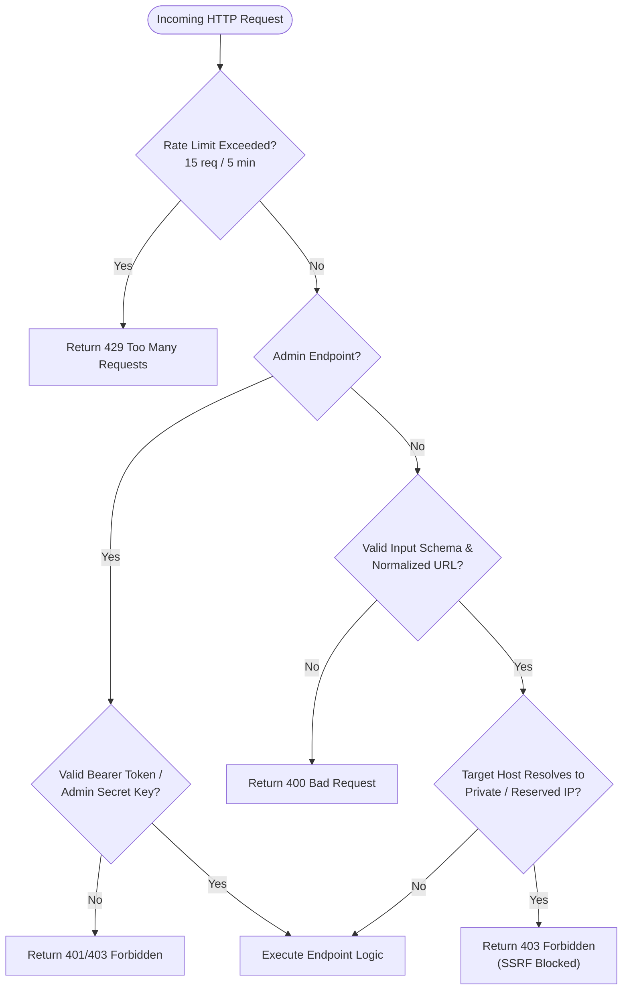

# Phish-Guard Backend, APIs, Data Models & Tech Stack Specification

## 1. Executive Overview

This document provides the technical specification of the **Phish-Guard (AV-SAFE)** backend infrastructure, REST API endpoints, Mongoose data models, security controls, and supporting technology stack.

The backend is built natively within **Next.js 16 (App Router)** as asynchronous Node.js server route handlers. It provides:
1. **Active Deep Network Inspection**: Asynchronous DNS resolution, TLS certificate validation, and remote HTML inspection protected against Server-Side Request Forgery (SSRF).
2. **Scan Telemetry & History**: Ingestion and retrieval of user scan events with automatic duplicate normalization.
3. **Incident Reporting & SecOps Triage**: Idempotent reporting of confirmed phishing links with client IP rate limiting, duplicate suppression, and administrative review workflows.
4. **Resilient Connection Pooling**: MongoDB connectivity configured to resolve Atlas SRV records and cache connections across serverless and hot-reload lifecycles.

---

## 2. Technology Stack Matrix

| Architectural Layer | Technology / Library | Version | Purpose & Implementation Details |
| :--- | :--- | :--- | :--- |
| **Backend Runtime** | Node.js | `>= 18.18.0` | Native asynchronous runtime executing Next.js route handlers |
| **Application Framework** | Next.js (App Router) | `16.2.10` | Full-stack framework hosting serverless REST API endpoints (`src/app/api/`) |
| **Database Engine** | MongoDB Atlas / Local | `>= 6.0` | Document database for persistent telemetry and threat complaints |
| **Object Data Modeling** | Mongoose | `9.7.3` | Schema definition, validation, compound indexes, and query casting |
| **DNS Resolution** | Node.js `dns` module | Built-in | Hostname A/AAAA record lookup with custom public fallback resolvers (`8.8.8.8`, `1.1.1.1`) |
| **TLS/SSL Handshake** | Node.js `https` module | Built-in | Raw socket connection, peer certificate extraction, and expiration validation |
| **Network IP Validation** | Node.js `net` module | Built-in | Bitwise and regex inspection of IPv4/IPv6 addresses for anti-SSRF defense |
| **Remote HTML Fetching** | Fetch API (`node-fetch` engine) | Built-in | Page retrieval with `AbortController`, 512 KB memory limit, and `redirect: 'manual'` |
| **Rate Limiting** | Sliding Window In-Memory Store | Custom | IP-based request throttling with automatic map cleanup |
| **Authentication** | Bearer Token / Custom Header / Cookie | Custom | Administrative access control (`ADMIN_SECRET_KEY`) |

### Environment Variables

| Variable | Required | Default / Fallback | Description |
| :--- | :---: | :--- | :--- |
| `MONGODB_URI` | Yes | `mongodb+srv://...` | Connection URI string for MongoDB cluster |
| `ADMIN_SECRET_KEY` | Optional | `phishguard-secops-admin-key-2026` | Secret key required to access `/api/admin/*` endpoints |
| `NODE_ENV` | Optional | `development` | Environment mode (`development`, `production`, `test`) |
| `PORT` | Optional | `3000` | Port for local Next.js HTTP server |

---

## 3. Database Architecture & Data Models

Database models reside in [`src/lib/models/`](file:///c:/Users/gamin/OneDrive/Desktop/AV-SAFE/src/lib/models/) and utilize Mongoose ODM schemas.

### 3.1. Database Connection Management (`src/lib/mongodb.js`)

To guarantee fast serverless execution and prevent socket exhaustion during Next.js Hot Module Replacement (HMR):
* **Custom DNS Servers**: Uses `dns.setServers(['8.8.8.8', '1.1.1.1'])` to guarantee reliable resolution of MongoDB Atlas SRV connection strings in local environments.
* **Global Connection Caching**: Caches the active mongoose connection object in `global.mongoose = { conn: null, promise: null }`.
* **Fail-Fast Configuration**: Sets `bufferCommands: false` to fail immediately if the database is unreachable, avoiding request hangs.

---

### 3.2. Data Model: `UrlScan` (`src/lib/models/UrlScan.js`)

Stores historical telemetry of evaluated URLs from the web console.

```javascript
const UrlScanSchema = new mongoose.Schema({
  url: { type: String, required: true },
  rating: { type: String, required: true },
  score: { type: Number, required: true },
  date: { type: String, default: () => new Date().toLocaleDateString() },
  createdAt: { type: Date, default: Date.now }
});
```

#### Field Specifications:

| Field Name | Type | Required | Constraints / Enums | Description |
| :--- | :---: | :---: | :--- | :--- |
| `_id` | `ObjectId` | Auto | Unique Primary Key | Mongoose document identifier |
| `url` | `String` | Yes | Max 2048 chars | The original target URL scanned |
| `rating` | `String` | Yes | `'SAFE' \| 'SUSPICIOUS' \| 'DANGEROUS'` | Qualitative safety verdict |
| `score` | `Number` | Yes | Range `0 - 100` | Numerical safety score (100 = safe, 0 = critical threat) |
| `date` | `String` | Yes | Localized date string | Human-readable date formatted for display |
| `createdAt` | `Date` | Yes | Default `Date.now` | Indexed timestamp for chronological sorting |

---

### 3.3. Data Model: `Complaint` (`src/lib/models/Complaint.js`)

Stores user-submitted threat reports and flagged links from Android, Web, and the Browser Extension.

```javascript
const ComplaintSchema = new mongoose.Schema(
  {
    complaintId: { type: String, required: true, unique: true, index: true },
    userId: { type: String, default: null, index: true },
    reporterType: { type: String, enum: ['AUTHENTICATED', 'GUEST'], default: 'GUEST', required: true },
    source: { type: String, enum: ['ANDROID_BROWSER', 'WEB_SCANNER', 'EXTENSION'], default: 'ANDROID_BROWSER', required: true },
    originalUrl: { type: String, required: true, maxlength: 2048 },
    normalizedUrl: { type: String, required: true, maxlength: 2048 },
    hostname: { type: String, required: true, maxlength: 255, index: true },
    category: { type: String, enum: ['PHISHING', 'MALWARE', 'FAKE_LOGIN', 'SCAM', 'SUSPICIOUS_REDIRECT', 'OTHER'], default: 'PHISHING', required: true, index: true },
    description: { type: String, maxlength: 2000, default: '' },
    detectionVerdict: { type: String, enum: ['SAFE', 'SUSPICIOUS', 'DANGEROUS', 'UNKNOWN'], required: true, index: true },
    safetyScore: { type: Number, min: 0, max: 100, required: true },
    detectionReasons: { type: [String], default: [] },
    engineVersion: { type: String, default: '1.0.0' },
    detectedAt: { type: Date, default: Date.now },
    userConfirmedAt: { type: Date, required: true },
    status: { type: String, enum: ['REGISTERED', 'UNDER_REVIEW', 'RESOLVED', 'REJECTED'], default: 'REGISTERED', index: true },
    adminNotes: { type: String, maxlength: 3000, default: '' },
    clientIp: { type: String, default: null },
    idempotencyKey: { type: String, default: null, index: true }
  },
  { timestamps: true }
);

// Compound indexes for high-throughput queries
ComplaintSchema.index({ status: 1, createdAt: -1 });
ComplaintSchema.index({ hostname: 1, createdAt: -1 });
```

#### Field Specifications:

| Field Name | Type | Required | Constraints / Enums | Description |
| :--- | :---: | :---: | :--- | :--- |
| `complaintId` | `String` | Yes | Unique, Indexed, Format: `PG-YYYY-XXXXXX` | Human-readable tracking ID (e.g. `PG-2026-104928`) |
| `userId` | `String` | No | Default `null` | Optional identifier if reported by authenticated user |
| `reporterType` | `String` | Yes | `'AUTHENTICATED' \| 'GUEST'` | Submission origin trust level |
| `source` | `String` | Yes | `'ANDROID_BROWSER' \| 'WEB_SCANNER' \| 'EXTENSION'` | Ingress client platform |
| `originalUrl` | `String` | Yes | Max 2048 characters | Raw URL submitted by user |
| `normalizedUrl` | `String` | Yes | Max 2048 characters | Canonicalized and sanitized URL |
| `hostname` | `String` | Yes | Indexed, Max 255 chars | Extracted domain/host of target |
| `category` | `String` | Yes | `'PHISHING' \| 'MALWARE' \| 'FAKE_LOGIN' \| 'SCAM' \| 'SUSPICIOUS_REDIRECT' \| 'OTHER'` | Threat classification |
| `description` | `String` | No | Max 2000 characters | User-provided notes or attack context |
| `detectionVerdict`| `String` | Yes | `'SAFE' \| 'SUSPICIOUS' \| 'DANGEROUS' \| 'UNKNOWN'` | Engine verdict at time of submission |
| `safetyScore` | `Number` | Yes | Range `0 - 100` | Safety score calculated at time of submission |
| `detectionReasons`| `[String]` | Yes | Default `[]` | List of heuristic warning strings |
| `engineVersion` | `String` | Yes | Default `'1.0.0'` | Engine release version |
| `detectedAt` | `Date` | Yes | Default `Date.now` | Client detection timestamp |
| `userConfirmedAt`| `Date` | Yes | Required | Timestamp when user confirmed incident submission |
| `status` | `String` | Yes | `'REGISTERED' \| 'UNDER_REVIEW' \| 'RESOLVED' \| 'REJECTED'` | SecOps review lifecycle state |
| `adminNotes` | `String` | No | Max 3000 characters | Internal triage notes added by SecOps team |
| `clientIp` | `String` | No | Extracted header string | Reporter IP address used for rate limiting |
| `idempotencyKey` | `String` | No | Indexed UUID string | Unique client key to prevent duplicate submissions |
| `createdAt` | `Date` | Auto | Timestamps option | Record creation timestamp |
| `updatedAt` | `Date` | Auto | Timestamps option | Record update timestamp |

---

## 4. REST API Endpoint Specifications

All endpoints are hosted under `/api/*`.

```
/api
├── /analyze                     # Deep active network probe & SSRF guard
├── /history                     # User scan history telemetry
├── /complaints                  # Public incident submission & ID tracking
└── /admin
    └── /complaints              # SecOps administrative triage & updates
        └── /[complaintId]       # Single incident fetch & status patch
```

---

### 4.1. `POST /api/analyze` — Deep Active Network Scanner

Performs real-time, server-side active inspection of a target URL including DNS A/AAAA resolution, TLS certificate validation, and remote HTML inspection, protected by strict anti-SSRF filtering.

* **Path**: `/api/analyze`
* **Method**: `POST`
* **Access**: Public
* **Source File**: [`src/app/api/analyze/route.js`](file:///c:/Users/gamin/OneDrive/Desktop/AV-SAFE/src/app/api/analyze/route.js)

#### Request Headers:
```http
Content-Type: application/json
```

#### Request Body Schema:
```json
{
  "url": "https://example-suspicious-login.com/auth"
}
```

| Parameter | Type | Required | Validation Rules |
| :--- | :---: | :---: | :--- |
| `url` | `String` | Yes | Must be a valid HTTP or HTTPS string $\le 2048$ chars. Non-HTTP protocols (`file:`, `javascript:`, `data:`, `blob:`) are rejected. |

#### Internal Processing Pipeline:
1. **Validation & Normalization**: Strips whitespace, parses protocol and hostname via `validateAndNormalizeUrl()`.
2. **DNS Resolution & SSRF Guard**:
   - Calls `dns.lookup(hostname, { all: true })`.
   - Validates all resolved IP addresses against `isPrivateOrReservedIP()`.
   - **SSRF Block Trigger**: If any resolved IP belongs to loopback (`127.0.0.0/8`), private networks (`10.0.0.0/8`, `172.16.0.0/12`, `192.168.0.0/16`), cloud metadata (`169.254.0.0/16`), CGNAT (`100.64.0.0/10`), or IPv6 internal (`::1`, `fe80::`, `fc00::`), the request is immediately terminated with **HTTP 403 Forbidden**.
3. **Parallel Active Probes** (`Promise.all`):
   - **TLS Certificate Probe** (`getSSLCertDetails`):
     - Establishes HTTPS connection on port 443 with `rejectUnauthorized: true` (3500ms timeout).
     - Extracts: Issuer, Subject, Valid From/To, Fingerprint, Serial Number, Expired flag, and Self-Signed flag.
   - **DOM & Form Analysis** (`fetchAndAnalyzeHTML`):
     - Initiates HTTP GET with custom `User-Agent` and 4000ms timeout.
     - Enforces `redirect: 'manual'` to prevent following open redirects into internal private networks.
     - Truncates response stream to 512 KB (524,288 bytes) to prevent buffer exhaustion.
     - Inspects HTML for: `<title>`, presence of `<input type="password">`, login form counts, meta refresh tags, script redirection (`window.location`), and third-party form actions.

#### Success Response (`200 OK`):
```json
{
  "hostname": "example-suspicious-login.com",
  "dns": {
    "active": true,
    "ip": "93.184.216.34",
    "family": 4,
    "allAddresses": ["93.184.216.34"],
    "isPrivate": false
  },
  "ssl": {
    "hasCert": true,
    "issuer": "Let's Encrypt",
    "subject": "example-suspicious-login.com",
    "validFrom": "Oct 1 00:00:00 2026 GMT",
    "validTo": "Dec 30 23:59:59 2026 GMT",
    "fingerprint": "8F:3A:0D:B2:K9:S7:Q6:E1:P5:MR:5T:W9:UV:4Y:XZ",
    "serialNumber": "03A4B5C6D7E8F9",
    "isExpired": false,
    "isSelfSigned": false
  },
  "page": {
    "success": true,
    "title": "Account Verification Portal",
    "hasPasswordInput": true,
    "loginFormsCount": 1,
    "hasMetaRedirect": false,
    "hasScriptRedirect": false,
    "hasExternalForm": true
  }
}
```

#### Error Responses:
* `400 Bad Request`: `{"error": "URL is required and must be a string"}`
* `403 Forbidden` (SSRF Prevention):
```json
{
  "hostname": "169.254.169.254",
  "error": "Access to private or reserved IP address is forbidden for security reasons",
  "dns": { "active": true, "ip": "169.254.169.254", "isPrivate": true },
  "ssl": { "hasCert": false, "error": "Restricted target" },
  "page": { "success": false, "error": "Restricted target" }
}
```
* `500 Internal Server Error`: `{"error": "Internal server error processing analysis"}`

---

### 4.2. `GET /api/history` — Fetch Scan History

Retrieves the latest 50 scan records recorded from the dashboard.

* **Path**: `/api/history`
* **Method**: `GET`
* **Access**: Public
* **Source File**: [`src/app/api/history/route.js`](file:///c:/Users/gamin/OneDrive/Desktop/AV-SAFE/src/app/api/history/route.js)

#### Success Response (`200 OK`):
```json
[
  {
    "url": "https://accounts.google.com",
    "rating": "SAFE",
    "score": 100,
    "date": "10/29/2026"
  },
  {
    "url": "http://192.168.1.1/admin-panel",
    "rating": "DANGEROUS",
    "score": 15,
    "date": "10/29/2026"
  }
]
```

---

### 4.3. `POST /api/history` — Record Scan Telemetry

Saves a completed URL evaluation. Normalizes previous entries for the same URL.

* **Path**: `/api/history`
* **Method**: `POST`
* **Access**: Public
* **Source File**: [`src/app/api/history/route.js`](file:///c:/Users/gamin/OneDrive/Desktop/AV-SAFE/src/app/api/history/route.js)

#### Request Body Schema:
```json
{
  "url": "https://secure-paypal-verify.com",
  "rating": "DANGEROUS",
  "score": 10
}
```

#### Processing Rules:
1. Validates URL through `validateAndNormalizeUrl()`.
2. Clamps rating to `['SAFE', 'SUSPICIOUS', 'DANGEROUS']`.
3. Clamps score to integer in range `0 - 100`.
4. Executes `UrlScan.deleteMany({ url: validUrl.originalUrl })` to prevent duplicates.
5. Inserts new record and returns `200 OK`.

#### Success Response (`200 OK`):
```json
{
  "success": true,
  "data": {
    "_id": "67210e30d24bf1a09e0a4f91",
    "url": "https://secure-paypal-verify.com",
    "rating": "DANGEROUS",
    "score": 10,
    "date": "10/29/2026",
    "createdAt": "2026-10-29T10:18:09.123Z"
  }
}
```

---

### 4.4. `DELETE /api/history` — Clear Scan History

Purges all entries from the `UrlScan` collection.

* **Path**: `/api/history`
* **Method**: `DELETE`
* **Access**: Public
* **Success Response (`200 OK`)**:
```json
{
  "success": true,
  "message": "Scan history cleared successfully"
}
```

---

### 4.5. `POST /api/complaints` — Submit Incident Report

Receives user incident reports from Android, Web, or the Browser Extension.

* **Path**: `/api/complaints`
* **Method**: `POST`
* **Access**: Public (Rate-Limited)
* **Source File**: [`src/app/api/complaints/route.js`](file:///c:/Users/gamin/OneDrive/Desktop/AV-SAFE/src/app/api/complaints/route.js)

#### Rate Limiting:
* Enforces **15 requests per 5 minutes per IP**. Returns `429 Too Many Requests` when exceeded.

#### Request Body Schema:
```json
{
  "confirmed": true,
  "originalUrl": "http://paypal-verification-update.xyz/login",
  "category": "PHISHING",
  "description": "SMS phishing link claiming my account was locked.",
  "detectionVerdict": "DANGEROUS",
  "safetyScore": 10,
  "detectionReasons": [
    "Brand Spoofing / Hijacking: Contains 'paypal' outside official domain",
    "Insecure Connection: Missing SSL/HTTPS",
    "Suspicious TLD: Top-level domain '.xyz' is frequently abused"
  ],
  "source": "ANDROID_BROWSER",
  "idempotencyKey": "a8f3b1c9-7d42-4f11-9a3e-2b5d6e8f0a1c"
}
```

#### Processing Pipeline:
1. **IP Extraction**: Extracts client IP from `x-forwarded-for` or `x-real-ip`.
2. **Rate Limit Evaluation**: Checked via `checkRateLimit('complaint_' + ip, 15, 300000)`.
3. **Payload Validation**: `validateComplaintInput()` verifies `confirmed === true`, valid URL, and allowed category/verdict.
4. **Idempotency Check**: If `idempotencyKey` matches an existing record, returns the existing record (`200 OK`) without creating duplicates.
5. **2-Minute Duplicate Check**: Disallows the same IP from filing the identical URL within 120 seconds.
6. **Collision-Resistant ID Generation**: Generates `PG-YYYY-XXXXXX` (5 retry attempts on collision).
7. **Storage**: Inserts record into MongoDB with initial status `'REGISTERED'`.

#### Success Response (`201 Created`):
```json
{
  "success": true,
  "complaintId": "PG-2026-834912",
  "status": "REGISTERED",
  "message": "Complaint submitted successfully and queued for security review."
}
```

#### Error Responses:
* `400 Bad Request`: `{"error": "Explicit user confirmation is required to submit a complaint report"}`
* `429 Too Many Requests`: `{"error": "Rate limit exceeded. Please wait a few minutes before submitting another report."}`
* `500 Internal Server Error`: `{"error": "Internal server error while processing complaint"}`

---

### 4.6. `GET /api/complaints` — Public Incident Status Lookup

Allows end-users to check the investigation status of their filed report using their tracking ID.

* **Path**: `/api/complaints?id={complaintId}`
* **Method**: `GET`
* **Access**: Public (Filtered)
* **Query Parameters**:
  * `id`: Tracking ID (e.g. `PG-2026-834912`).

#### Security Filtering:
* Prohibits listing full collections without authentication (`401 Unauthorized`).
* Sanitizes returned object by stripping internal SecOps fields: `-adminNotes -clientIp`.

#### Success Response (`200 OK`):
```json
{
  "success": true,
  "data": {
    "complaintId": "PG-2026-834912",
    "hostname": "paypal-verification-update.xyz",
    "category": "PHISHING",
    "description": "SMS phishing link claiming my account was locked.",
    "detectionVerdict": "DANGEROUS",
    "safetyScore": 10,
    "status": "UNDER_REVIEW",
    "detectedAt": "2026-10-29T10:15:00.000Z",
    "createdAt": "2026-10-29T10:15:12.000Z"
  }
}
```

#### Error Responses:
* `401 Unauthorized`: Attempting to call `GET /api/complaints` without an `?id=` parameter.
* `404 Not Found`: `{"error": "Complaint not found"}`

---

### 4.7. `GET /api/admin/complaints` — SecOps Incident Management Query

Administrative endpoint used by the SecOps console to search, filter, paginate, and view system metrics.

* **Path**: `/api/admin/complaints`
* **Method**: `GET`
* **Access**: Admin Authentication Required
* **Source File**: [`src/app/api/admin/complaints/route.js`](file:///c:/Users/gamin/OneDrive/Desktop/AV-SAFE/src/app/api/admin/complaints/route.js)

#### Authentication Headers (Any of the following):
```http
Authorization: Bearer <ADMIN_SECRET_KEY>
x-admin-key: <ADMIN_SECRET_KEY>
Cookie: phishguard_admin_token=<ADMIN_SECRET_KEY>
```

#### Query Parameters:
| Parameter | Type | Default | Description |
| :--- | :---: | :---: | :--- |
| `page` | `Integer` | `1` | Page number ($\ge 1$) |
| `limit` | `Integer` | `20` | Page size (clamped $1 - 100$) |
| `status` | `String` | `'ALL'` | Filter by status: `'REGISTERED'`, `'UNDER_REVIEW'`, `'RESOLVED'`, `'REJECTED'` |
| `category` | `String` | `'ALL'` | Filter by category: `'PHISHING'`, `'MALWARE'`, etc. |
| `verdict` | `String` | `'ALL'` | Filter by verdict: `'SAFE'`, `'SUSPICIOUS'`, `'DANGEROUS'` |
| `search` | `String` | `null` | Sanitized substring regex across `complaintId`, `hostname`, `originalUrl` |

#### Success Response (`200 OK`):
```json
{
  "success": true,
  "data": [
    {
      "_id": "67210e30d24bf1a09e0a4f91",
      "complaintId": "PG-2026-834912",
      "reporterType": "GUEST",
      "source": "ANDROID_BROWSER",
      "originalUrl": "http://paypal-verification-update.xyz/login",
      "hostname": "paypal-verification-update.xyz",
      "category": "PHISHING",
      "status": "REGISTERED",
      "detectionVerdict": "DANGEROUS",
      "safetyScore": 10,
      "detectionReasons": ["Brand Spoofing / Hijacking"],
      "adminNotes": "",
      "clientIp": "192.168.0.105",
      "createdAt": "2026-10-29T10:15:12.000Z"
    }
  ],
  "pagination": {
    "page": 1,
    "limit": 20,
    "total": 45,
    "totalPages": 3
  },
  "stats": {
    "total": 45,
    "registered": 12,
    "underReview": 8,
    "resolved": 21,
    "dangerous": 39
  }
}
```

---

### 4.8. `PATCH /api/admin/complaints` & `PATCH /api/admin/complaints/[complaintId]`

Updates an incident's triage lifecycle state and appends investigation notes.

* **Paths**:
  * `PATCH /api/admin/complaints` (with `complaintId` in body)
  * `PATCH /api/admin/complaints/{complaintId}`
* **Method**: `PATCH`
* **Access**: Admin Authentication Required
* **Source Files**:
  * [`src/app/api/admin/complaints/route.js`](file:///c:/Users/gamin/OneDrive/Desktop/AV-SAFE/src/app/api/admin/complaints/route.js)
  * [`src/app/api/admin/complaints/[complaintId]/route.js`](file:///c:/Users/gamin/OneDrive/Desktop/AV-SAFE/src/app/api/admin/complaints/%5BcomplaintId%5D/route.js)

#### Request Body Schema:
```json
{
  "complaintId": "PG-2026-834912",
  "status": "UNDER_REVIEW",
  "adminNotes": "Confirmed brand impersonation targeting PayPal login credentials. Submitted to upstream PhishTank feed."
}
```

| Parameter | Type | Required | Allowed Values / Constraints |
| :--- | :---: | :---: | :--- |
| `complaintId` | `String` | Yes* | Required in body if calling root PATCH; extracted from URL params if calling dynamic route |
| `status` | `String` | No | `'REGISTERED' \| 'UNDER_REVIEW' \| 'RESOLVED' \| 'REJECTED'` |
| `adminNotes` | `String` | No | Max 3000 characters |

#### Success Response (`200 OK`):
```json
{
  "success": true,
  "data": {
    "complaintId": "PG-2026-834912",
    "status": "UNDER_REVIEW",
    "adminNotes": "Confirmed brand impersonation targeting PayPal login credentials. Submitted to upstream PhishTank feed.",
    "updatedAt": "2026-10-29T10:25:40.000Z"
  },
  "message": "Complaint updated successfully."
}
```

---

## 5. Security & Resilience Architecture



### 5.1. Comprehensive Anti-SSRF Defense Engine (`src/lib/security/urlValidation.js`)

Before any server-side socket or HTTP request is initiated in `/api/analyze`, the hostname is resolved to its underlying IP addresses and filtered through `isPrivateOrReservedIP()`:

| Subnet Range | Classification / RFC | Threat Prevented |
| :--- | :--- | :--- |
| `0.0.0.0/8` | Broadcast / Current Network | Internal host discovery |
| `10.0.0.0/8` | RFC 1918 Class A Private | Corporate intranet reconnaissance |
| `127.0.0.0/8` | RFC 1122 Loopback | Localhost service exploitation (Redis, DBs, Docker) |
| `169.254.0.0/16` | RFC 3927 Link-Local / Cloud Metadata | **Cloud credential theft** (AWS EC2 / GCP metadata endpoints) |
| `172.16.0.0/12` | RFC 1918 Class B Private | VPC / internal network access |
| `192.168.0.0/16` | RFC 1918 Class C Private | Home / enterprise LAN scanning |
| `100.64.0.0/10` | RFC 6598 Carrier-Grade NAT | Telco internal routing probe |
| `192.0.2.0/24`, `198.51.100.0/24`, `203.0.113.0/24` | RFC 5737 TEST-NET documentation | Test network abuse |
| `224.0.0.0/4` | RFC 1112 Multicast | Network storm injection |
| `240.0.0.0/4` | RFC 1112 Reserved / Experimental | Reserved range probing |
| `255.255.255.255` | Broadcast | Subnet-wide ping amplification |
| `::1`, `::` | IPv6 Loopback / Unspecified | Localhost IPv6 bypassing |
| `fe80::/10` | RFC 4291 IPv6 Link-Local | Router link exploitation |
| `fc00::/7`, `fd00::/7` | RFC 4193 IPv6 Unique Local Address | Internal private IPv6 subnets |
| `::ffff:0:0/96` | IPv4-Mapped IPv6 | IPv6 wrapping to bypass IPv4 firewall rules |

### 5.2. Memory & Network Guardrails

1. **Stream Capping**: All remote HTML bodies in `fetchAndAnalyzeHTML` are sliced at **512 KB** (`text.slice(0, 524288)`) to eliminate Out-Of-Memory (OOM) attack vectors via large files.
2. **Explicit Timeouts**:
   - TLS Handshake Socket: **3500ms**
   - Remote HTTP Page Inspection: **4000ms** (via `AbortController`)
3. **Manual Redirect Policy**: `redirect: 'manual'` ensures that even if an initial domain passes SSRF validation, an HTTP 301/302 cannot redirect the server into an internal metadata endpoint.
4. **Regex Injection (ReDoS) Defense**: Search queries in `/api/admin/complaints` pass through a regex sanitizer (`search.replace(/[-\/\\^$*+?.()|[\]{}]/g, '\\$&')`) before compiling Mongoose queries.

