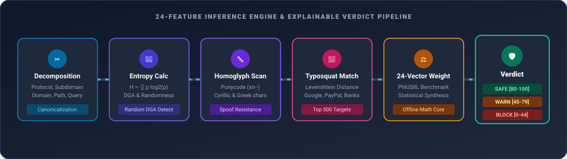
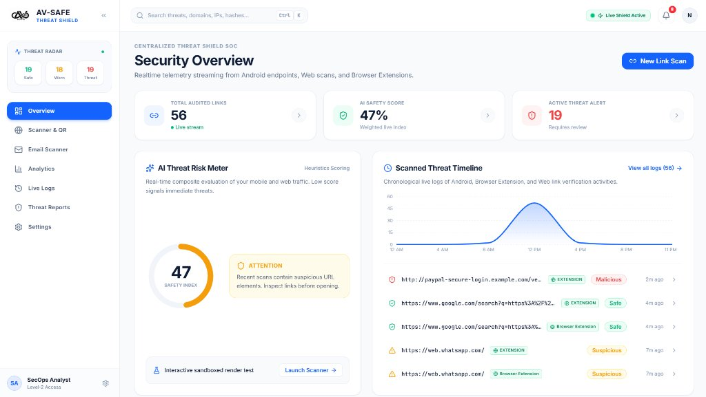
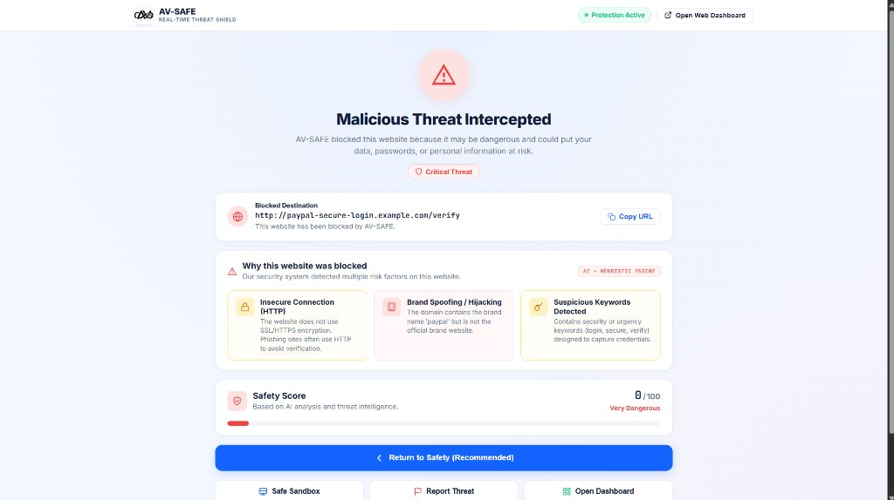
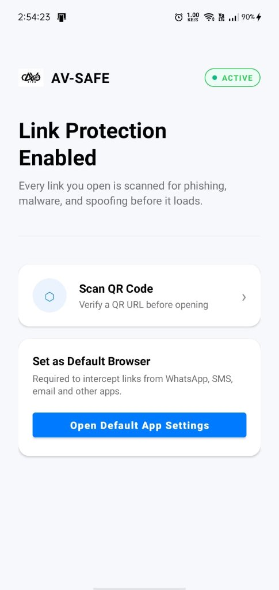
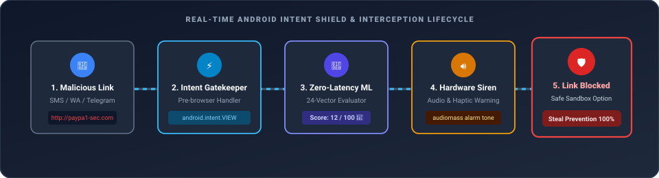

<!-- AV-SAFE — Advanced Phishing Detection System — Minor Project README -->

<div align="center">

<br/>

# AV-SAFE
### Advanced Phishing Detection System

**Minor Project — B.Tech CSE | 2026**

<br/>

[](https://nextjs.org/)
[](https://react.dev/)
[](https://tailwindcss.com/)
[](https://mongodb.com/)
[](./extansion)
[](./android-app)
[](./mlservice)
[](./LICENSE)

<br/>


<br/><br/>

</div>

---

## About the Project

AV-SAFE is a cross-platform, real-time phishing URL detection system built as a minor academic project. It combines a machine learning model trained on **235,795 real phishing and legitimate URLs** with client-side inference engines embedded natively in a web application, Chrome browser extension, and an Android mobile app.

No external API calls are required at runtime. The ML model runs fully offline, achieving **< 10 ms detection latency**.

---

## System Architecture

<div align="center">



<br/><br/>



</div>

---

## Platform Coverage

<div align="center">


<br/><br/>

| Feature | Web App | Chrome Extension | Android App |
| :--- | :---: | :---: | :---: |
| Phishing URL Scanner | ✅ | ✅ | ✅ |
| Offline ML Detection | ✅ | ✅ | ✅ |
| QR Code Phishing Scanner | — | — | ✅ |
| Intent Gatekeeper | — | — | ✅ |
| Real-time Threat Feed | ✅ | ✅ | — |
| SOC Dashboard | ✅ | — | — |

</div>

---

## Machine Learning Engine

The detection core is a **Logistic Regression (SGD)** model trained end-to-end on the **PhiUSIIL Phishing URL Dataset** via the `mlservice/` training pipeline included in this repository.

### Dataset Summary

| Property | Value |
| :--- | :--- |
| Dataset | PhiUSIIL Phishing URL (Website) Dataset |
| Total Records | 235,795 URLs |
| After Deduplication | 235,370 URLs |
| Legitimate URLs | 134,510 (57.15%) |
| Phishing URLs | 100,860 (42.85%) |
| Unique Domains | 220,086 |
| Split Strategy | Domain-Grouped (zero leakage) |
| Train / Val / Test | 70% / 15% / 15% |

### Feature Engineering

The model uses **24 URL-only runtime signals** extracted entirely offline (no network access needed):

```
url_length          domain_length       is_ip               tld_length
subdomain_count     is_https            letters             letter_ratio
digits              digit_ratio         special             special_ratio
equals_count        qmark_count         amp_count           hyphen_count
dots_count          slash_count         shannon_entropy     sensitive_words_count
is_shortened        is_suspicious_tld   is_typosquatting    brand_abuse_triggered
```

---

## Model Benchmark Results

Evaluated on **35,150 unseen-domain URLs** (domains never seen during training):

| Model | Accuracy | Precision | Recall | F1-Score | ROC-AUC | FPR | Latency |
| :--- | :---: | :---: | :---: | :---: | :---: | :---: | :---: |
| **LightGBM** ⭐ Top Overall | **99.72%** | 99.89% | **99.44%** | **99.66%** | **0.9989** | 0.08% | 0.003 ms |
| **XGBoost** | 99.71% | **99.91%** | 99.41% | **99.66%** | **0.9990** | **0.06%** | 0.001 ms |
| **Random Forest** | 99.66% | 99.89% | 99.32% | 99.60% | 0.9990 | 0.08% | 0.002 ms |
| **SGD Classifier** 🚀 Deployed | 99.43% | **99.91%** | 98.75% | 99.33% | 0.9981 | **0.06%** | **< 0.001 ms** |

> All results measured on **35,150 URLs from domains never seen during training** (domain-grouped split — zero data leakage guaranteed).

### Key Accuracy Highlights

- **Best Overall Accuracy:** LightGBM at **99.72%** — catches 14,818 out of 14,902 phishing URLs
- **Best False Positive Rate:** SGD & XGBoost at **0.06%** — only 13 legitimate sites wrongly flagged out of 20,248
- **Best ROC-AUC:** XGBoost & Random Forest at **0.9990** — near-perfect phishing vs. legitimate discrimination
- **Deployed Production Model (SGD):** 99.43% accuracy, 13 false positives, 187 missed phishing URLs
- **Inference Speed:** SGD scores any URL in **< 0.001 ms** — suitable for real-time mobile and browser use

> **SGD Classifier** was selected for production deployment because its linear dot-product inference (`z = bias + Σ (x - μ)/σ · w`) is natively computed inside `phishingEngine.js` and `PhishingEngine.kt` with zero external dependencies.

---

## Confusion Matrices (Unseen-Domain Test Set)

### SGD Classifier — Deployed to Production

```
                  Predicted: Safe    Predicted: Phishing
Actual: Safe         20,235  ✅              13  ⚠️
Actual: Phishing        187  ❌          14,715  ✅
```

### LightGBM — Top Overall Accuracy

```
                  Predicted: Safe    Predicted: Phishing
Actual: Safe         20,232  ✅              16  ⚠️
Actual: Phishing         84  ❌          14,818  ✅
```

### XGBoost

```
                  Predicted: Safe    Predicted: Phishing
Actual: Safe         20,235  ✅              13  ⚠️
Actual: Phishing         88  ❌          14,814  ✅
```

### Random Forest

```
                  Predicted: Safe    Predicted: Phishing
Actual: Safe         20,231  ✅              17  ⚠️
Actual: Phishing        102  ❌          14,800  ✅
```

> ✅ Correctly classified &nbsp;|&nbsp; ⚠️ False Positive (safe flagged) &nbsp;|&nbsp; ❌ False Negative (phishing missed)

---

## Screenshots

<div align="center">

| SOC Dashboard | Threat Analytics |
| :---: | :---: |
|  |  |

<br/>

| Chrome Extension Interception | Android Link Shield |
| :---: | :---: |
|  |  |

<br/>



</div>

---

## Running the ML Training Pipeline

The full ML training service lives inside `mlservice/`:

```bash
cd mlservice
source .venv/bin/activate

# 1. Analyze dataset
python train.py --analyze-only

# 2. Train all 4 models
python train.py --all

# 3. Compare benchmarks
python compare_models.py

# 4. Export + deploy JSON weights to production
python export.py --deploy
```

ML reports, charts, ROC curves, PR curves, feature importance plots, and confusion matrix heatmaps are saved to `mlservice/reports/`.

---

## Quickstart — Web Application

```bash
# Clone
git clone https://github.com/Anmol-Malviya/AV-SAFE.git
cd AV-SAFE

# Install dependencies
npm install

# Run locally
npm run dev
```

---

## Project Structure

```text
AV-SAFE/
├── src/                        # Next.js web application
│   ├── app/                    # Pages, API routes
│   └── lib/
│       ├── phishingEngine.js   # Offline ML inference engine (JavaScript)
│       └── phishing_model_weights.json   # Trained model weights (24 features)
├── extansion/                  # Chrome MV3 extension with embedded engine
├── android-app/                # Android Kotlin app with PhishingEngine.kt
├── mlservice/                  # ML training pipeline (Python 3.12)
│   ├── config/                 # training_config.yaml, feature_config.yaml
│   ├── src/                    # Data, features, training, evaluation, export
│   ├── models/trained/         # SGD, RF, XGBoost, LightGBM artifacts
│   ├── reports/                # Confusion matrices, ROC/PR curves, charts
│   └── train.py                # CLI entry point
└── dataset/
    └── PhiUSIIL_Phishing_URL_Dataset.csv   # 235,795 URL training dataset
```

---

## Tech Stack

| Layer | Technology |
| :--- | :--- |
| Frontend | Next.js 16, React 19, TailwindCSS v4 |
| Backend / API | Next.js API Routes, MongoDB Atlas |
| ML Training | Python 3.12, Scikit-learn, XGBoost, LightGBM |
| Browser Extension | Chrome MV3, Vanilla JS |
| Mobile | Android (Kotlin), Intent Gatekeeper |
| ML Inference | Zero-dependency linear arithmetic (JS + Kotlin) |

---

## Team

<div align="center">

|  |  |  |
| :---: | :---: | :---: |
| **Anmol Malviya** | **Tanay Agrawal** | **Hritik Jaiswal** |
| AI / Threat Intelligence Lead | Full-Stack Systems Lead | Security / Mobile Lead |

<br/>

---

© 2026 AV-SAFE Security Ecosystem — MIT Licensed

</div>
