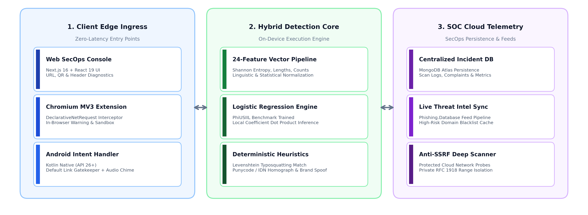
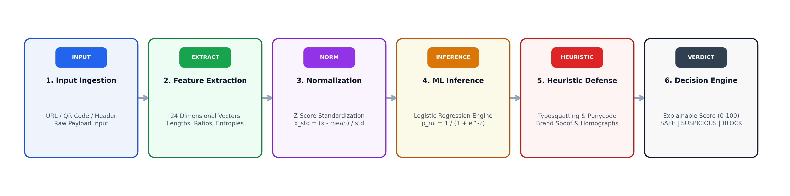

<!-- ==========================================
     AV-SAFE SEC-OPS DASHBOARD UI/UX README
     Theme: Enterprise White Dashboard Design System
     ========================================== -->

<div align="center" style="background-color: #F8FAFC; padding: 24px 16px; border-radius: 20px; border: 1px solid #E2E8F0; margin-bottom: 24px;">

  <!-- TOP HEADER / SEC-OPS NAV BAR -->
  <table width="100%" border="0" cellspacing="0" cellpadding="0" style="background: #FFFFFF; border-radius: 14px; border: 1px solid #E2E8F0; padding: 12px 20px; box-shadow: 0 2px 8px rgba(0,0,0,0.03);">
    <tr>
      <td align="left" valign="middle">
        <div style="display: flex; align-items: center; gap: 12px;">
          
          <span style="font-size: 20px; font-weight: 800; color: #0F172A; letter-spacing: -0.5px; vertical-align: middle;">
            AV-SAFE <span style="font-size: 13px; font-weight: 600; color: #1463FF; background: #EFF6FF; border: 1px solid #DBEAFE; padding: 3px 9px; border-radius: 9999px; margin-left: 6px;">SecOps Threat Shield v2.4</span>
          </span>
        </div>
      </td>
      <td align="right" valign="middle">
        <a href="http://localhost:3000/system" style="text-decoration: none; font-size: 12px; font-weight: 600; color: #FFFFFF; background: #1463FF; padding: 8px 14px; border-radius: 8px; margin-right: 6px;">⚡ Open Dashboard</a>
        <a href="http://localhost:3000" style="text-decoration: none; font-size: 12px; font-weight: 600; color: #334155; background: #F1F5F9; border: 1px solid #CBD5E1; padding: 7px 12px; border-radius: 8px; margin-right: 6px;">🌐 Live Scanner</a>
        <a href="#android-link-shield" style="text-decoration: none; font-size: 12px; font-weight: 600; color: #334155; background: #F1F5F9; border: 1px solid #CBD5E1; padding: 7px 12px; border-radius: 8px;">📱 Mobile App</a>
      </td>
    </tr>
  </table>

  <br />

  <!-- HERO BANNER CARD -->
  <div style="background: #FFFFFF; border: 1px solid #E2E8F0; border-radius: 16px; overflow: hidden; box-shadow: 0 4px 20px rgba(0,0,0,0.04);">
    
    
    <div style="padding: 24px 28px; text-align: left;">
      <h1 style="margin: 0; font-size: 26px; font-weight: 800; color: #0F172A; line-height: 1.3;">
        Next-Generation Multi-Platform Cybersecurity & Real-Time Phishing Threat Defense
      </h1>
      <p style="margin: 8px 0 16px 0; font-size: 14px; color: #64748B; line-height: 1.6;">
        An explainable cybersecurity ecosystem pairing a <b>24-Feature Machine Learning Inference Engine</b> (PhiUSIIL benchmark) with a <b>Deterministic Heuristic Defense Matrix</b> across Web, Chromium MV3 Extensions, and Native Android devices.
      </p>
      
      <div style="display: flex; gap: 8px; flex-wrap: wrap;">
        
        
        
        
        
        
        
      </div>
    </div>
  </div>

  <br />

  <!-- STATS & KPI METRIC CARDS -->
  <table width="100%" border="0" cellspacing="10" cellpadding="0">
    <tr>
      <td width="25%" valign="top" style="background: #FFFFFF; border: 1px solid #E2E8F0; border-radius: 14px; padding: 18px; box-shadow: 0 2px 6px rgba(0,0,0,0.02); text-align: left;">
        <span style="font-size: 11px; font-weight: 700; color: #64748B; text-transform: uppercase; letter-spacing: 0.5px;">Detection Speed</span>
        <div style="font-size: 26px; font-weight: 800; color: #0F172A; margin: 4px 0;">&lt; 10ms</div>
        <div style="font-size: 11px; color: #16A34A; font-weight: 600;">⚡ 100% Zero-Latency Edge</div>
      </td>
      <td width="25%" valign="top" style="background: #FFFFFF; border: 1px solid #E2E8F0; border-radius: 14px; padding: 18px; box-shadow: 0 2px 6px rgba(0,0,0,0.02); text-align: left;">
        <span style="font-size: 11px; font-weight: 700; color: #64748B; text-transform: uppercase; letter-spacing: 0.5px;">ML Feature Vectors</span>
        <div style="font-size: 26px; font-weight: 800; color: #1463FF; margin: 4px 0;">24 Signals</div>
        <div style="font-size: 11px; color: #64748B; font-weight: 500;">Structural + Entropy + TLD</div>
      </td>
      <td width="25%" valign="top" style="background: #FFFFFF; border: 1px solid #E2E8F0; border-radius: 14px; padding: 18px; box-shadow: 0 2px 6px rgba(0,0,0,0.02); text-align: left;">
        <span style="font-size: 11px; font-weight: 700; color: #64748B; text-transform: uppercase; letter-spacing: 0.5px;">Active Threat Feed</span>
        <div style="font-size: 26px; font-weight: 800; color: #E11D48; margin: 4px 0;">Real-Time</div>
        <div style="font-size: 11px; color: #64748B; font-weight: 500;">Phishing.Database Sync</div>
      </td>
      <td width="25%" valign="top" style="background: #FFFFFF; border: 1px solid #E2E8F0; border-radius: 14px; padding: 18px; box-shadow: 0 2px 6px rgba(0,0,0,0.02); text-align: left;">
        <span style="font-size: 11px; font-weight: 700; color: #64748B; text-transform: uppercase; letter-spacing: 0.5px;">Ecosystem Platforms</span>
        <div style="font-size: 26px; font-weight: 800; color: #7C3AED; margin: 4px 0;">3 Clients</div>
        <div style="font-size: 11px; color: #64748B; font-weight: 500;">Web • Chrome MV3 • Android</div>
      </td>
    </tr>
  </table>

</div>

<!-- ==========================================
     SECTION 1: ARCHITECTURE & CROSS-DEVICE
     ========================================== -->

<div style="background: #FFFFFF; border: 1px solid #E2E8F0; border-radius: 18px; padding: 32px 28px; box-shadow: 0 4px 16px rgba(0,0,0,0.03); margin-bottom: 24px;">

  <div style="border-bottom: 1px solid #F1F5F9; padding-bottom: 12px; margin-bottom: 24px;">
    <h2 style="margin: 0; font-size: 22px; font-weight: 800; color: #0F172A;">
      🏛️ End-to-End System Architecture
    </h2>
    <p style="margin: 4px 0 0 0; font-size: 13px; color: #64748B;">
      Tri-tier deployment isolating edge client ingress, offline hybrid ML inference, and cloud SecOps persistence.
    </p>
  </div>

  <div align="center" style="background: #F8FAFC; border: 1px solid #E2E8F0; border-radius: 16px; padding: 20px; margin-bottom: 28px;">
    
    <p style="margin: 12px 0 0 0; font-size: 12px; font-weight: 600; color: #64748B;">
      Figure 1.0 — Architecture Workflow: Ingress Clients (Web, Extension, Android) ➔ Hybrid Detection Core ➔ SOC Cloud Telemetry
    </p>
  </div>

  <div style="border-bottom: 1px solid #F1F5F9; padding-bottom: 12px; margin-bottom: 24px;">
    <h2 style="margin: 0; font-size: 22px; font-weight: 800; color: #0F172A;">
      🛡️ Cross-Device Real-Time Interception Surfaces
    </h2>
    <p style="margin: 4px 0 0 0; font-size: 13px; color: #64748B;">
      Protecting users across their entire device footprint with identical sub-10ms defensive guarantees.
    </p>
  </div>

  <div align="center" style="background: #F8FAFC; border: 1px solid #E2E8F0; border-radius: 16px; padding: 24px; margin-bottom: 12px;">
    
    <p style="margin: 12px 0 0 0; font-size: 12px; font-weight: 600; color: #64748B;">
      Figure 1.1 — Unified multi-platform client support across Laptop, Desktop, and Mobile form factors
    </p>
  </div>

</div>

<!-- ==========================================
     SECTION 2: LIVE SOC SECOPS DASHBOARD
     ========================================== -->

<div style="background: #FFFFFF; border: 1px solid #E2E8F0; border-radius: 18px; padding: 32px 28px; box-shadow: 0 4px 16px rgba(0,0,0,0.03); margin-bottom: 24px;">

  <div style="border-bottom: 1px solid #F1F5F9; padding-bottom: 12px; margin-bottom: 24px;">
    <h2 style="margin: 0; font-size: 22px; font-weight: 800; color: #0F172A;">
      📊 Real-Time SOC SecOps Operations Dashboard
    </h2>
    <p style="margin: 4px 0 0 0; font-size: 13px; color: #64748B;">
      Centralized analytics displaying 24-hour scan volumes, multi-client telemetry distributions, targeted enterprise brand attacks, and active neural weights.
    </p>
  </div>

  <div align="center" style="background: #F8FAFC; border: 1px solid #E2E8F0; border-radius: 16px; padding: 20px; margin-bottom: 24px;">
    
    <p style="margin: 12px 0 0 0; font-size: 12px; font-weight: 600; color: #64748B;">
      Figure 2.0 — Live SecOps SOC Operations Console: Real-time scan telemetry, safe vs malicious ratios, and source splits
    </p>
  </div>

  <div align="center" style="background: #F8FAFC; border: 1px solid #E2E8F0; border-radius: 16px; padding: 20px;">
    
    <p style="margin: 12px 0 0 0; font-size: 12px; font-weight: 600; color: #64748B;">
      Figure 2.1 — Granular breakdown: Targeted brands, top malicious TLD distributions, and neural coefficient verification
    </p>
  </div>

</div>

<!-- ==========================================
     SECTION 3: CLIENT INTERCEPTION INTERFACES
     ========================================== -->

<div style="background: #FFFFFF; border: 1px solid #E2E8F0; border-radius: 18px; padding: 32px 28px; box-shadow: 0 4px 16px rgba(0,0,0,0.03); margin-bottom: 24px;">

  <div style="border-bottom: 1px solid #F1F5F9; padding-bottom: 12px; margin-bottom: 24px;">
    <h2 style="margin: 0; font-size: 22px; font-weight: 800; color: #0F172A;">
      ⚡ Real-Time Edge Interception Interfaces
    </h2>
    <p style="margin: 4px 0 0 0; font-size: 13px; color: #64748B;">
      Hardware sound warnings and clean UI prompts to stop credential theft before navigation initiates.
    </p>
  </div>

  <table width="100%" border="0" cellspacing="16" cellpadding="0" style="margin-bottom: 24px;">
    <tr>
      <!-- Browser Extension -->
      <td width="58%" valign="top" style="background: #FAFAFA; border: 1px solid #E2E8F0; border-radius: 14px; padding: 18px;">
        <div style="display: flex; align-items: center; justify-content: space-between; margin-bottom: 10px;">
          <span style="font-size: 14px; font-weight: 700; color: #0F172A;">Chromium Extension Threat Guard</span>
          <span style="font-size: 10px; font-weight: 700; background: #FEE2E2; color: #991B1B; padding: 2px 8px; border-radius: 9999px;">MANIFEST V3</span>
        </div>
        
        <p style="font-size: 12px; color: #475569; line-height: 1.5; margin: 0;">
          Intercepts navigation at socket creation. Renders clear heuristic failure reasons, exact risk score meters, and offers isolated Safe Sandbox preview.
        </p>
      </td>
      <!-- Android Native Screen -->
      <td width="42%" valign="top" align="center" style="background: #FAFAFA; border: 1px solid #E2E8F0; border-radius: 14px; padding: 18px;" id="android-link-shield">
        <div style="display: flex; align-items: center; justify-content: space-between; margin-bottom: 10px; width: 100%;">
          <span style="font-size: 14px; font-weight: 700; color: #0F172A;">Android Link Shield</span>
          <span style="font-size: 10px; font-weight: 700; background: #DCFCE7; color: #166534; padding: 2px 8px; border-radius: 9999px;">KOTLIN NATIVE</span>
        </div>
        
        <p style="font-size: 12px; color: #475569; line-height: 1.5; margin: 0; text-align: left;">
          Hardware alert tone triggered on malicious interception. Protects links from SMS, WhatsApp, Gmail, and Telegram before browser handover.
        </p>
      </td>
    </tr>
  </table>

  <!-- MOBILE INTENT & QUISHING DEEP DIVE -->
  <table width="100%" border="0" cellspacing="16" cellpadding="0">
    <tr>
      <td width="50%" valign="middle" align="center" style="background: #FAFAFA; border: 1px solid #E2E8F0; border-radius: 14px; padding: 24px;">
        
        <div style="margin-top: 14px; text-align: left;">
          <div style="font-size: 14px; font-weight: 700; color: #0F172A;">Android Intent Gatekeeper Architecture</div>
          <p style="font-size: 12px; color: #64748B; margin: 4px 0 0 0; line-height: 1.5;">
            Registers <code>android.intent.action.VIEW</code> filters for <code>http</code> and <code>https</code>. Executes on-device Kotlin scoring prior to spawning browser WebViews.
          </p>
        </div>
      </td>
      <td width="50%" valign="middle" align="center" style="background: #FAFAFA; border: 1px solid #E2E8F0; border-radius: 14px; padding: 24px;">
        <div style="background: #FFFFFF; border: 1px solid #CBD5E1; border-radius: 12px; padding: 14px; display: inline-block;">
          
        </div>
        <div style="margin-top: 14px; text-align: left;">
          <div style="font-size: 14px; font-weight: 700; color: #0F172A;">Privacy-First Quishing (QR) Scanner</div>
          <p style="font-size: 12px; color: #64748B; margin: 4px 0 0 0; line-height: 1.5;">
            Zero-cloud client camera video stream processing using <code>html5-qrcode</code>. Extracts embedded URLs and immediately evaluates them with the 24-feature ML engine.
          </p>
        </div>
      </td>
    </tr>
  </table>

</div>

<!-- ==========================================
     SECTION 4: 4-PANEL WEB DIAGNOSTIC SUITE
     ========================================== -->

<div style="background: #FFFFFF; border: 1px solid #E2E8F0; border-radius: 18px; padding: 32px 28px; box-shadow: 0 4px 16px rgba(0,0,0,0.03); margin-bottom: 24px;">

  <div style="border-bottom: 1px solid #F1F5F9; padding-bottom: 12px; margin-bottom: 24px;">
    <h2 style="margin: 0; font-size: 22px; font-weight: 800; color: #0F172A;">
      🔍 Modular Threat Diagnostic Suites
    </h2>
    <p style="margin: 4px 0 0 0; font-size: 13px; color: #64748B;">
      Explore the comprehensive analytical modules built into the web security console.
    </p>
  </div>

  <table width="100%" border="0" cellspacing="16" cellpadding="0">
    <tr>
      <!-- Panel 1 -->
      <td width="50%" valign="top" style="background: #FAFAFA; border: 1px solid #E2E8F0; border-radius: 14px; padding: 18px;">
        <div style="display: flex; align-items: center; justify-content: space-between; margin-bottom: 10px;">
          <span style="font-size: 14px; font-weight: 700; color: #0F172A;">1. 24-Feature URL Scanner</span>
          <span style="font-size: 10px; font-weight: 700; background: #DBEAFE; color: #1E40AF; padding: 2px 8px; border-radius: 9999px;">ML + HEURISTICS</span>
        </div>
        
        <p style="font-size: 12px; color: #475569; line-height: 1.5; margin: 0;">
          Extracts Shannon entropy, structural syntax lengths, suspicious TLD indicators, sensitive keyword patterns, and Punycode homograph scripts.
        </p>
      </td>
      <!-- Panel 2 -->
      <td width="50%" valign="top" style="background: #FAFAFA; border: 1px solid #E2E8F0; border-radius: 14px; padding: 18px;">
        <div style="display: flex; align-items: center; justify-content: space-between; margin-bottom: 10px;">
          <span style="font-size: 14px; font-weight: 700; color: #0F172A;">2. Threat Feeds & Protection</span>
          <span style="font-size: 10px; font-weight: 700; background: #DCFCE7; color: #166534; padding: 2px 8px; border-radius: 9999px;">ZERO-LATENCY</span>
        </div>
        
        <p style="font-size: 12px; color: #475569; line-height: 1.5; margin: 0;">
          Automated edge-cache synchronization with active phishing databases and real-time blacklists to intercept known malicious campaigns instantly.
        </p>
      </td>
    </tr>
    <tr>
      <!-- Panel 3 -->
      <td width="50%" valign="top" style="background: #FAFAFA; border: 1px solid #E2E8F0; border-radius: 14px; padding: 18px;">
        <div style="display: flex; align-items: center; justify-content: space-between; margin-bottom: 10px;">
          <span style="font-size: 14px; font-weight: 700; color: #0F172A;">3. Email RFC 822 Header Parser</span>
          <span style="font-size: 10px; font-weight: 700; background: #FEF3C7; color: #92400E; padding: 2px 8px; border-radius: 9999px;">SPF / DKIM / DMARC</span>
        </div>
        
        <p style="font-size: 12px; color: #475569; line-height: 1.5; margin: 0;">
          Inspects raw headers for cryptographic SPF authentication, DKIM digital signatures, and DMARC domain alignment to expose spoofed sender addresses.
        </p>
      </td>
      <!-- Panel 4 -->
      <td width="50%" valign="top" style="background: #FAFAFA; border: 1px solid #E2E8F0; border-radius: 14px; padding: 18px;">
        <div style="display: flex; align-items: center; justify-content: space-between; margin-bottom: 10px;">
          <span style="font-size: 14px; font-weight: 700; color: #0F172A;">4. Mobile Gateway & Sandboxing</span>
          <span style="font-size: 10px; font-weight: 700; background: #F3E8FF; color: #6B21A8; padding: 2px 8px; border-radius: 9999px;">KOTLIN ART ENGINE</span>
        </div>
        
        <p style="font-size: 12px; color: #475569; line-height: 1.5; margin: 0;">
          On-device intent handler guarding links across messaging apps, triggering hardware alarm notifications and providing a scriptless sandbox preview.
        </p>
      </td>
    </tr>
  </table>

</div>

<!-- ==========================================
     SECTION 5: DETECTION PIPELINE & TIERS
     ========================================== -->

<div style="background: #FFFFFF; border: 1px solid #E2E8F0; border-radius: 18px; padding: 32px 28px; box-shadow: 0 4px 16px rgba(0,0,0,0.03); margin-bottom: 24px;">

  <div style="border-bottom: 1px solid #F1F5F9; padding-bottom: 12px; margin-bottom: 20px;">
    <h2 style="margin: 0; font-size: 22px; font-weight: 800; color: #0F172A;">
      🧠 Hybrid Detection Engine Pipeline
    </h2>
    <p style="margin: 4px 0 0 0; font-size: 13px; color: #64748B;">
      Deterministic 6-stage pipeline executing zero-latency on-device inference without cloud dependencies.
    </p>
  </div>

  <!-- Pipeline Graphic -->
  <div align="center" style="background: #F8FAFC; border: 1px solid #E2E8F0; border-radius: 16px; padding: 16px; margin-bottom: 28px;">
    
  </div>

  <!-- Scoring Tier Matrix Graphic -->
  <div style="border-bottom: 1px solid #F1F5F9; padding-bottom: 12px; margin-bottom: 20px;">
    <h2 style="margin: 0; font-size: 20px; font-weight: 800; color: #0F172A;">
      ⚖️ Dynamic Threat Scoring Matrix
    </h2>
    <p style="margin: 4px 0 0 0; font-size: 13px; color: #64748B;">
      Explainable risk tiers and automated enforcement policies based on combined scores.
    </p>
  </div>

  <div align="center" style="background: #F8FAFC; border: 1px solid #E2E8F0; border-radius: 16px; padding: 16px; margin-bottom: 20px;">
    
  </div>

  <table width="100%" border="0" cellspacing="0" cellpadding="10" style="border-collapse: collapse; font-size: 13px; border: 1px solid #E2E8F0; border-radius: 10px; overflow: hidden;">
    <thead>
      <tr style="background: #F1F5F9; color: #0F172A; text-align: left;">
        <th style="padding: 12px; border-bottom: 1px solid #E2E8F0;">Score Range</th>
        <th style="padding: 12px; border-bottom: 1px solid #E2E8F0;">Classification</th>
        <th style="padding: 12px; border-bottom: 1px solid #E2E8F0;">Heuristic Indicators Triggered</th>
        <th style="padding: 12px; border-bottom: 1px solid #E2E8F0;">Ecosystem Action</th>
      </tr>
    </thead>
    <tbody>
      <tr>
        <td style="padding: 12px; border-bottom: 1px solid #E2E8F0; font-weight: bold; color: #16A34A;">80 – 100</td>
        <td style="padding: 12px; border-bottom: 1px solid #E2E8F0;"><span style="background: #DCFCE7; color: #166534; font-weight: 700; padding: 2px 8px; border-radius: 4px;">SAFE</span></td>
        <td style="padding: 12px; border-bottom: 1px solid #E2E8F0; color: #475569;">Verified root domains, valid SSL cert, 0 heuristic triggers, balanced character entropy.</td>
        <td style="padding: 12px; border-bottom: 1px solid #E2E8F0; color: #16A34A; font-weight: 600;">Allow Immediate Navigation</td>
      </tr>
      <tr>
        <td style="padding: 12px; border-bottom: 1px solid #E2E8F0; font-weight: bold; color: #D97706;">45 – 79</td>
        <td style="padding: 12px; border-bottom: 1px solid #E2E8F0;"><span style="background: #FEF3C7; color: #92400E; font-weight: 700; padding: 2px 8px; border-radius: 4px;">SUSPICIOUS</span></td>
        <td style="padding: 12px; border-bottom: 1px solid #E2E8F0; color: #475569;">Abusive TLD (.xyz, .top), high entropy, deep subdomain count (&gt;3), suspicious paths.</td>
        <td style="padding: 12px; border-bottom: 1px solid #E2E8F0; color: #D97706; font-weight: 600;">Warn User + Offer Safe Sandbox</td>
      </tr>
      <tr>
        <td style="padding: 12px; font-weight: bold; color: #DC2626;">0 – 44</td>
        <td style="padding: 12px;"><span style="background: #FEE2E2; color: #991B1B; font-weight: 700; padding: 2px 8px; border-radius: 4px;">DANGEROUS</span></td>
        <td style="padding: 12px; color: #475569;">Confirmed typosquatting, IDN homoglyphs, brand keyword spoofing, or blacklist match.</td>
        <td style="padding: 12px; color: #DC2626; font-weight: 600;">Hard Intercept + Audio Hazard Alert</td>
      </tr>
    </tbody>
  </table>

</div>

<!-- ==========================================
     SECTION 6: TECHNOLOGY STACK
     ========================================== -->

<div style="background: #FFFFFF; border: 1px solid #E2E8F0; border-radius: 18px; padding: 32px 28px; box-shadow: 0 4px 16px rgba(0,0,0,0.03); margin-bottom: 24px;">

  <div style="border-bottom: 1px solid #F1F5F9; padding-bottom: 12px; margin-bottom: 20px;">
    <h2 style="margin: 0; font-size: 22px; font-weight: 800; color: #0F172A;">
      🛠️ Technology Stack & Engineering Specifications
    </h2>
  </div>

  <table width="100%" border="0" cellspacing="10" cellpadding="0">
    <tr>
      <td width="33.3%" valign="top" style="background: #F8FAFC; border: 1px solid #E2E8F0; border-radius: 12px; padding: 18px;">
        <div style="font-size: 14px; font-weight: 700; color: #0F172A; margin-bottom: 8px;">🌐 Web SecOps Platform</div>
        <ul style="margin: 0; padding-left: 18px; font-size: 12px; color: #475569; line-height: 1.8;">
          <li><b>Next.js 16.2.10</b> (App Router)</li>
          <li><b>React 19.2.4</b> with Turbopack</li>
          <li><b>Tailwind CSS v4</b> + PostCSS</li>
          <li><b>Recharts 3.9</b> (Real-Time Visuals)</li>
          <li><b>Framer Motion 12.42</b></li>
          <li><b>MongoDB & Mongoose 9.7</b></li>
        </ul>
      </td>
      <td width="33.3%" valign="top" style="background: #F8FAFC; border: 1px solid #E2E8F0; border-radius: 12px; padding: 18px;">
        <div style="font-size: 14px; font-weight: 700; color: #0F172A; margin-bottom: 8px;">🧩 Browser Extension</div>
        <ul style="margin: 0; padding-left: 18px; font-size: 12px; color: #475569; line-height: 1.8;">
          <li><b>Chromium Manifest V3</b> Standard</li>
          <li><b>DeclarativeNetRequest</b> Filtering</li>
          <li><b>Local Offline Inference</b> (&lt;10ms)</li>
          <li><b>Scriptless Iframe Sandbox</b></li>
          <li><b>Phishing.Database</b> Cache Sync</li>
          <li>Chrome, Edge, Brave, Opera</li>
        </ul>
      </td>
      <td width="33.3%" valign="top" style="background: #F8FAFC; border: 1px solid #E2E8F0; border-radius: 12px; padding: 18px;">
        <div style="font-size: 14px; font-weight: 700; color: #0F172A; margin-bottom: 8px;">📱 Android Native Client</div>
        <ul style="margin: 0; padding-left: 18px; font-size: 12px; color: #475569; line-height: 1.8;">
          <li><b>Kotlin Native</b> (Android 8.0+ / API 26+)</li>
          <li><b>Deep Intent Gatekeeper</b> (VIEW)</li>
          <li><b>Hardware Audio Alerts</b> (MediaPlayer)</li>
          <li><b>Retrofit2 / OkHttp</b> Telemetry</li>
          <li><b>Offline Heuristic Port</b></li>
          <li>SecOps Complaint Dispatch</li>
        </ul>
      </td>
    </tr>
  </table>

</div>

<!-- ==========================================
     SECTION 7: DEPLOYMENT GUIDE
     ========================================== -->

<div style="background: #FFFFFF; border: 1px solid #E2E8F0; border-radius: 18px; padding: 32px 28px; box-shadow: 0 4px 16px rgba(0,0,0,0.03); margin-bottom: 24px;">

  <div style="border-bottom: 1px solid #F1F5F9; padding-bottom: 12px; margin-bottom: 20px;">
    <h2 style="margin: 0; font-size: 22px; font-weight: 800; color: #0F172A;">
      ⚙️ Deployment & Quickstart Guide
    </h2>
  </div>

  ### 1. Web SecOps Platform Setup
  ```bash
  # 1. Clone the project repository
  git clone https://github.com/Anmol-Malviya/AV-SAFE.git
  cd AV-SAFE

  # 2. Install project dependencies
  npm install

  # 3. Configure environment variables in .env.local
  # MONGODB_URI=mongodb://localhost:27017/av-safe
  # PORT=3000

  # 4. Start Next.js development server
  npm run dev
  ```
  * Access **Landing Page & Web Scanner**: [http://localhost:3000](http://localhost:3000)
  * Access **SecOps SOC Dashboard**: [http://localhost:3000/system](http://localhost:3000/system)

  <br />

  ### 2. Browser Extension Installation
  1. Open Chrome and navigate to `chrome://extensions/`.
  2. Enable **Developer mode** in the upper-right corner.
  3. Click **Load unpacked** and select the [`extansion`](./extansion) directory.
  4. The **AV-SAFE Threat Shield** will activate in your extension dock.

  <br />

  ### 3. Android Client Setup
  1. Open the [`android-app`](./android-app) folder in **Android Studio** (Hedgehog or later).
  2. Sync Gradle dependencies.
  3. In `AppSyncManager.kt`, set your backend host IP (`http://10.0.2.2:3000` for Android emulator or your LAN IP for physical device).
  4. Build and install the APK onto your device. Set AV-SAFE as default link opener.

</div>

<!-- ==========================================
     SECTION 8: MEET THE BUILDERS
     ========================================== -->

<div style="background: #FFFFFF; border: 1px solid #E2E8F0; border-radius: 18px; padding: 32px 28px; box-shadow: 0 4px 16px rgba(0,0,0,0.03); margin-bottom: 24px;">

  <div align="center" style="margin-bottom: 24px;">
    <span style="font-size: 11px; font-weight: 800; color: #1463FF; background: #EFF6FF; border: 1px solid #DBEAFE; padding: 4px 12px; border-radius: 9999px; text-transform: uppercase; letter-spacing: 0.5px;">
      🏆 MEET THE BUILDERS
    </span>
    <h2 style="margin: 10px 0 4px 0; font-size: 24px; font-weight: 800; color: #0F172A;">
      Architected by Security & AI Pioneers
    </h2>
    <p style="margin: 0; font-size: 13px; color: #64748B;">
      The core engineering team behind AV-SAFE's zero-latency threat engine, mobile protections, and cloud intelligence.
    </p>
  </div>

  <table width="100%" border="0" cellspacing="12" cellpadding="0">
    <tr>
      <!-- Builder 1: Hritik -->
      <td width="33.3%" valign="top" style="background: #FAFAFA; border: 1px solid #E2E8F0; border-radius: 14px; padding: 22px; text-align: center;">
        
        <div style="font-size: 16px; font-weight: 800; color: #0F172A;">Hritik Jaishwal</div>
        <div style="font-size: 12px; font-weight: 600; color: #1463FF; margin-top: 2px;">Lead Security Researcher & ML Architect</div>
        <div style="font-size: 11px; font-weight: 500; color: #64748B; margin-top: 2px;">Phishing Detection Engine & Heuristics Core</div>
        <hr style="border: 0; border-top: 1px solid #E2E8F0; margin: 12px 0;" />
        <p style="font-size: 12px; color: #475569; line-height: 1.5; margin: 0; text-align: left;">
          Architected the 24-feature zero-latency URL scanner, Shannon entropy matrix, and heuristic defense against IDN homograph and typosquatting attacks.
        </p>
      </td>

      <!-- Builder 2: Tanay -->
      <td width="33.3%" valign="top" style="background: #FAFAFA; border: 1px solid #E2E8F0; border-radius: 14px; padding: 22px; text-align: center;">
        
        <div style="font-size: 16px; font-weight: 800; color: #0F172A;">Tanay Agrawal</div>
        <div style="font-size: 12px; font-weight: 600; color: #6366F1; margin-top: 2px;">Full-Stack & Systems Engineer</div>
        <div style="font-size: 11px; font-weight: 500; color: #64748B; margin-top: 2px;">Platform Architecture & Realtime Protection</div>
        <hr style="border: 0; border-top: 1px solid #E2E8F0; margin: 12px 0;" />
        <p style="font-size: 12px; color: #475569; line-height: 1.5; margin: 0; text-align: left;">
          Built the Next.js SecOps console, Android client infrastructure, telemetry-free on-device sandbox, and real-time Recharts dashboard visualization.
        </p>
      </td>

      <!-- Builder 3: Anmol -->
      <td width="33.3%" valign="top" style="background: #FAFAFA; border: 1px solid #E2E8F0; border-radius: 14px; padding: 22px; text-align: center;">
        
        <div style="font-size: 16px; font-weight: 800; color: #0F172A;">Anmol Malviya</div>
        <div style="font-size: 12px; font-weight: 600; color: #10B981; margin-top: 2px;">AI & Threat Intelligence Engineer</div>
        <div style="font-size: 11px; font-weight: 500; color: #64748B; margin-top: 2px;">RAG Pipeline & Model Retraining</div>
        <hr style="border: 0; border-top: 1px solid #E2E8F0; margin: 12px 0;" />
        <p style="font-size: 12px; color: #475569; line-height: 1.5; margin: 0; text-align: left;">
          Spearheaded threat intelligence vector embedding pipelines, automated phishing telemetry classification, and continuous feedback loop retraining.
        </p>
      </td>
    </tr>
  </table>

</div>

<!-- ==========================================
     FOOTER
     ========================================== -->

<div align="center" style="padding: 24px; color: #64748B; font-size: 12px;">
  <p style="margin: 0 0 6px 0;">
    Licensed under the <b>MIT License</b>. Built with precision for trustworthy and explainable cybersecurity defense.
  </p>
  <p style="margin: 0; font-weight: 600; color: #0F172A;">
    © AV-SAFE (Phish-Guard) Security Ecosystem. All rights reserved.
  </p>
</div>
