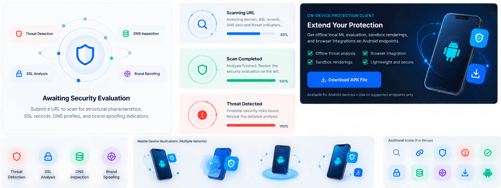
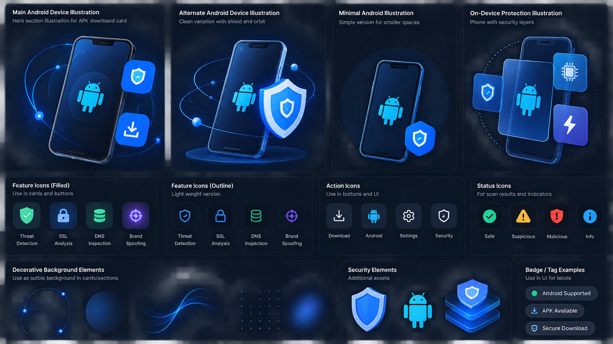
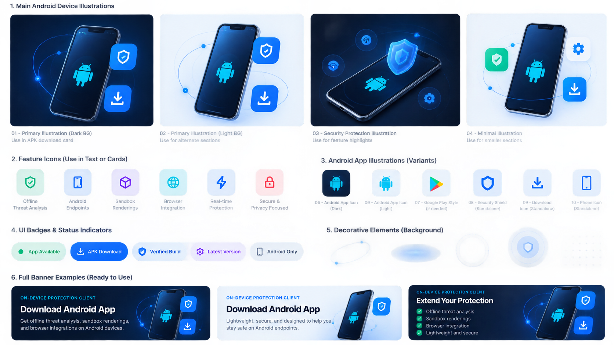
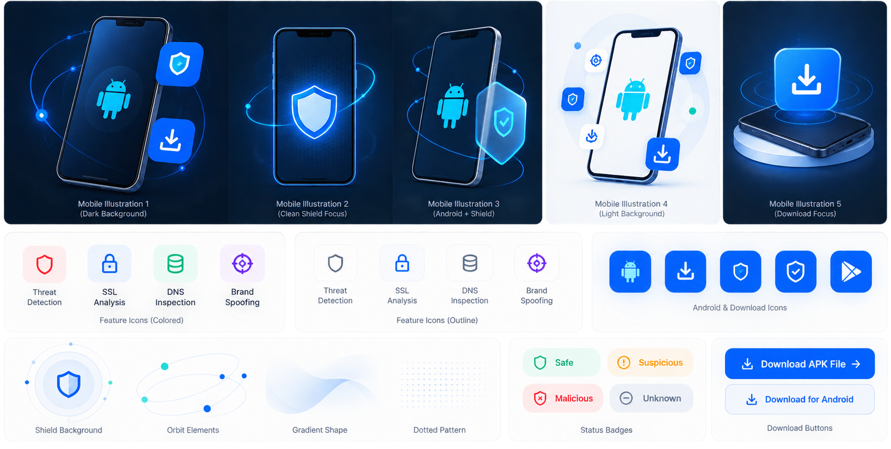
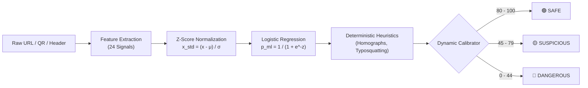

<!-- ==========================================
     AV-SAFE SEC-OPS DASHBOARD UI/UX README
     Theme: Modern Light / Clean White Enterprise Dashboard
     ========================================== -->

<div align="center" style="background-color: #F8FAFC; padding: 24px 16px; border-radius: 20px; border: 1px solid #E2E8F0; margin-bottom: 24px;">

  <!-- TOP HEADER / NAV BAR -->
  <table width="100%" border="0" cellspacing="0" cellpadding="0" style="background: #FFFFFF; border-radius: 14px; border: 1px solid #E2E8F0; padding: 12px 20px; box-shadow: 0 2px 8px rgba(0,0,0,0.03);">
    <tr>
      <td align="left" valign="middle">
        <div style="display: flex; align-items: center; gap: 12px;">
          
          <span style="font-size: 20px; font-weight: 800; color: #0F172A; letter-spacing: -0.5px; vertical-align: middle;">
            AV-SAFE <span style="font-size: 13px; font-weight: 600; color: #1463FF; background: #EFF6FF; border: 1px solid #DBEAFE; padding: 3px 8px; border-radius: 9999px; margin-left: 6px;">SecOps Console v2.4</span>
          </span>
        </div>
      </td>
      <td align="right" valign="middle">
        <a href="http://localhost:3000/system" style="text-decoration: none; font-size: 12px; font-weight: 600; color: #FFFFFF; background: #1463FF; padding: 8px 14px; border-radius: 8px; margin-right: 6px;">⚡ Open Dashboard</a>
        <a href="http://localhost:3000" style="text-decoration: none; font-size: 12px; font-weight: 600; color: #334155; background: #F1F5F9; border: 1px solid #CBD5E1; padding: 7px 12px; border-radius: 8px; margin-right: 6px;">🌐 Live Scanner</a>
        <a href="#android-mobile-client" style="text-decoration: none; font-size: 12px; font-weight: 600; color: #334155; background: #F1F5F9; border: 1px solid #CBD5E1; padding: 7px 12px; border-radius: 8px;">📱 Mobile App</a>
      </td>
    </tr>
  </table>

  <br />

  <!-- HERO BANNER -->
  <div style="background: #FFFFFF; border: 1px solid #E2E8F0; border-radius: 16px; overflow: hidden; box-shadow: 0 4px 20px rgba(0,0,0,0.04);">
    
    
    <div style="padding: 24px 28px; text-align: left;">
      <h1 style="margin: 0; font-size: 26px; font-weight: 800; color: #0F172A;">
        Real-Time Zero-Latency Multi-Platform Phishing & Cyber Threat Defense
      </h1>
      <p style="margin: 8px 0 16px 0; font-size: 14px; color: #64748B; line-height: 1.6;">
        An explainable cybersecurity ecosystem pairing a <b>24-Feature Machine Learning Inference Engine</b> (PhiUSIIL benchmark) with a <b>Deterministic Heuristic Defense Matrix</b> across Web, Chromium MV3 Extensions, and Native Android devices.
      </p>
      
      <div style="display: flex; gap: 8px; flex-wrap: wrap;">
        
        
        
        
        
        
        
      </div>
    </div>
  </div>

  <br />

  <!-- DASHBOARD STAT METRIC CARDS -->
  <table width="100%" border="0" cellspacing="10" cellpadding="0">
    <tr>
      <td width="25%" valign="top" style="background: #FFFFFF; border: 1px solid #E2E8F0; border-radius: 14px; padding: 18px; box-shadow: 0 2px 6px rgba(0,0,0,0.02); text-align: left;">
        <span style="font-size: 11px; font-weight: 700; color: #64748B; text-transform: uppercase; letter-spacing: 0.5px;">Detection Speed</span>
        <div style="font-size: 26px; font-weight: 800; color: #0F172A; margin: 4px 0;">&lt; 10ms</div>
        <div style="font-size: 11px; color: #16A34A; font-weight: 600;">⚡ 100% Zero-Latency Edge</div>
      </td>
      <td width="25%" valign="top" style="background: #FFFFFF; border: 1px solid #E2E8F0; border-radius: 14px; padding: 18px; box-shadow: 0 2px 6px rgba(0,0,0,0.02); text-align: left;">
        <span style="font-size: 11px; font-weight: 700; color: #64748B; text-transform: uppercase; letter-spacing: 0.5px;">ML Feature Vectors</span>
        <div style="font-size: 26px; font-weight: 800; color: #1463FF; margin: 4px 0;">24 Signals</div>
        <div style="font-size: 11px; color: #64748B; font-weight: 500;">Structural + Entropy + TLD</div>
      </td>
      <td width="25%" valign="top" style="background: #FFFFFF; border: 1px solid #E2E8F0; border-radius: 14px; padding: 18px; box-shadow: 0 2px 6px rgba(0,0,0,0.02); text-align: left;">
        <span style="font-size: 11px; font-weight: 700; color: #64748B; text-transform: uppercase; letter-spacing: 0.5px;">Active Threat Feed</span>
        <div style="font-size: 26px; font-weight: 800; color: #E11D48; margin: 4px 0;">Real-Time</div>
        <div style="font-size: 11px; color: #64748B; font-weight: 500;">Phishing.Database Sync</div>
      </td>
      <td width="25%" valign="top" style="background: #FFFFFF; border: 1px solid #E2E8F0; border-radius: 14px; padding: 18px; box-shadow: 0 2px 6px rgba(0,0,0,0.02); text-align: left;">
        <span style="font-size: 11px; font-weight: 700; color: #64748B; text-transform: uppercase; letter-spacing: 0.5px;">Ecosystem Platforms</span>
        <div style="font-size: 26px; font-weight: 800; color: #7C3AED; margin: 4px 0;">3 Clients</div>
        <div style="font-size: 11px; color: #64748B; font-weight: 500;">Web • Chrome MV3 • Android</div>
      </td>
    </tr>
  </table>

</div>

<!-- ==========================================
     MAIN DASHBOARD CONTAINER
     ========================================== -->

<div style="background: #FFFFFF; border: 1px solid #E2E8F0; border-radius: 18px; padding: 32px 28px; box-shadow: 0 4px 16px rgba(0,0,0,0.03); margin-bottom: 24px;">

  <!-- SECTION: CROSS-PLATFORM SURFACES -->
  <div style="border-bottom: 1px solid #F1F5F9; padding-bottom: 12px; margin-bottom: 24px;">
    <h2 style="margin: 0; font-size: 22px; font-weight: 800; color: #0F172A; display: flex; align-items: center; gap: 8px;">
      🛡️ Unified Ecosystem: Cross-Device Interception
    </h2>
    <p style="margin: 4px 0 0 0; font-size: 13px; color: #64748B;">
      Seamless protection across high-risk vector entry points: desktop browsers, enterprise web apps, and native mobile link handlers.
    </p>
  </div>

  <div align="center" style="background: #F8FAFC; border: 1px solid #E2E8F0; border-radius: 16px; padding: 24px; margin-bottom: 28px;">
    
    <p style="margin: 12px 0 0 0; font-size: 12px; font-weight: 600; color: #64748B;">
      Figure 1.0 — Unified deployment across Web SecOps Platform, Chromium Extension, and Android Intent Handler
    </p>
  </div>

  <!-- SECTION: SECOPS SOC TELEMETRY DASHBOARD -->
  <div style="border-bottom: 1px solid #F1F5F9; padding-bottom: 12px; margin-bottom: 24px;">
    <h2 style="margin: 0; font-size: 22px; font-weight: 800; color: #0F172A;">
      📊 Real-Time SOC SecOps Operations Console
    </h2>
    <p style="margin: 4px 0 0 0; font-size: 13px; color: #64748B;">
      Centralized analytics displaying 24-hour scan volumes, multi-client telemetry distributions, targeted enterprise brand attacks, and active neural weights.
    </p>
  </div>

  <div align="center" style="background: #F8FAFC; border: 1px solid #E2E8F0; border-radius: 16px; padding: 24px; margin-bottom: 32px;">
    
    <p style="margin: 12px 0 0 0; font-size: 12px; font-weight: 600; color: #64748B;">
      Figure 2.0 — SecOps Telemetry: Live AreaChart Volume, Origin Split (Android vs Extension vs Web), and Targeted Brands
    </p>
  </div>

  <!-- SECTION: BROWSER & ANDROID CLIENT INTERFACES -->
  <div style="border-bottom: 1px solid #F1F5F9; padding-bottom: 12px; margin-bottom: 24px;">
    <h2 style="margin: 0; font-size: 22px; font-weight: 800; color: #0F172A;">
      ⚡ Real-Time Edge Interception Interfaces
    </h2>
    <p style="margin: 4px 0 0 0; font-size: 13px; color: #64748B;">
      Active defense UI in action across Chromium extensions and native Android intent routing.
    </p>
  </div>

  <table width="100%" border="0" cellspacing="16" cellpadding="0" style="margin-bottom: 32px;">
    <tr>
      <td width="60%" valign="top" style="background: #FAFAFA; border: 1px solid #E2E8F0; border-radius: 14px; padding: 18px;">
        <div style="display: flex; align-items: center; justify-content: space-between; margin-bottom: 10px;">
          <span style="font-size: 14px; font-weight: 700; color: #0F172A;">Browser Extension Threat Interception</span>
          <span style="font-size: 10px; font-weight: 700; background: #FEE2E2; color: #991B1B; padding: 2px 8px; border-radius: 9999px;">CHROMIUM MV3</span>
        </div>
        
        <p style="font-size: 12px; color: #475569; line-height: 1.5; margin: 0;">
          Light-theme browser warning interceptor displaying exact heuristic failure triggers, dynamic risk calculation meters, and single-click isolated sandbox launching.
        </p>
      </td>
      <td width="40%" valign="top" align="center" style="background: #FAFAFA; border: 1px solid #E2E8F0; border-radius: 14px; padding: 18px;">
        <div style="display: flex; align-items: center; justify-content: space-between; margin-bottom: 10px; width: 100%;">
          <span style="font-size: 14px; font-weight: 700; color: #0F172A;">Android Link Shield</span>
          <span style="font-size: 10px; font-weight: 700; background: #DCFCE7; color: #166534; padding: 2px 8px; border-radius: 9999px;">KOTLIN NATIVE</span>
        </div>
        
        <p style="font-size: 12px; color: #475569; line-height: 1.5; margin: 0; text-align: left;">
          Native mobile alert with hardware warning sound feedback, deep link inspection, and direct SOC ticket submission.
        </p>
      </td>
    </tr>
  </table>

  <!-- SECTION: 4-PANEL THREAT DIAGNOSTICS SUITE -->
  <div style="border-bottom: 1px solid #F1F5F9; padding-bottom: 12px; margin-bottom: 24px;">
    <h2 style="margin: 0; font-size: 22px; font-weight: 800; color: #0F172A;">
      🔍 Modular Threat Diagnostic Suites
    </h2>
    <p style="margin: 4px 0 0 0; font-size: 13px; color: #64748B;">
      Deep dive into the 4 primary defensive interfaces engineered into the AV-SAFE platform.
    </p>
  </div>

  <table width="100%" border="0" cellspacing="16" cellpadding="0">
    <tr>
      <!-- Panel 1 -->
      <td width="50%" valign="top" style="background: #FAFAFA; border: 1px solid #E2E8F0; border-radius: 14px; padding: 18px;">
        <div style="display: flex; align-items: center; justify-content: space-between; margin-bottom: 10px;">
          <span style="font-size: 14px; font-weight: 700; color: #0F172A;">1. 24-Feature URL Scanner</span>
          <span style="font-size: 10px; font-weight: 700; background: #DBEAFE; color: #1E40AF; padding: 2px 8px; border-radius: 9999px;">ML + HEURISTICS</span>
        </div>
        
        <p style="font-size: 12px; color: #475569; line-height: 1.5; margin: 0;">
          Extracts Shannon entropy, structural syntax lengths, suspicious TLD indicators, sensitive keyword patterns, and Punycode homograph scripts.
        </p>
      </td>
      <!-- Panel 2 -->
      <td width="50%" valign="top" style="background: #FAFAFA; border: 1px solid #E2E8F0; border-radius: 14px; padding: 18px;">
        <div style="display: flex; align-items: center; justify-content: space-between; margin-bottom: 10px;">
          <span style="font-size: 14px; font-weight: 700; color: #0F172A;">2. Threat Feeds & Protection</span>
          <span style="font-size: 10px; font-weight: 700; background: #DCFCE7; color: #166534; padding: 2px 8px; border-radius: 9999px;">ZERO-LATENCY</span>
        </div>
        
        <p style="font-size: 12px; color: #475569; line-height: 1.5; margin: 0;">
          Automated edge-cache synchronization with active phishing databases and real-time blacklists to intercept known malicious campaigns instantly.
        </p>
      </td>
    </tr>
    <tr>
      <!-- Panel 3 -->
      <td width="50%" valign="top" style="background: #FAFAFA; border: 1px solid #E2E8F0; border-radius: 14px; padding: 18px;">
        <div style="display: flex; align-items: center; justify-content: space-between; margin-bottom: 10px;">
          <span style="font-size: 14px; font-weight: 700; color: #0F172A;">3. Email RFC 822 Header Parser</span>
          <span style="font-size: 10px; font-weight: 700; background: #FEF3C7; color: #92400E; padding: 2px 8px; border-radius: 9999px;">SPF / DKIM / DMARC</span>
        </div>
        
        <p style="font-size: 12px; color: #475569; line-height: 1.5; margin: 0;">
          Inspects raw headers for cryptographic SPF authentication, DKIM digital signatures, and DMARC domain alignment to expose spoofed sender addresses.
        </p>
      </td>
      <!-- Panel 4 -->
      <td width="50%" valign="top" style="background: #FAFAFA; border: 1px solid #E2E8F0; border-radius: 14px; padding: 18px;">
        <div style="display: flex; align-items: center; justify-content: space-between; margin-bottom: 10px;">
          <span style="font-size: 14px; font-weight: 700; color: #0F172A;">4. Mobile Gateway & Sandboxing</span>
          <span style="font-size: 10px; font-weight: 700; background: #F3E8FF; color: #6B21A8; padding: 2px 8px; border-radius: 9999px;">KOTLIN ART ENGINE</span>
        </div>
        
        <p style="font-size: 12px; color: #475569; line-height: 1.5; margin: 0;">
          On-device intent handler guarding links across messaging apps, triggering hardware alarm notifications and providing a scriptless sandbox preview.
        </p>
      </td>
    </tr>
  </table>

  <br />

  <!-- SECTION: MOBILE INTENT & QUISHING DEEP DIVE -->
  <div style="border-bottom: 1px solid #F1F5F9; padding-bottom: 12px; margin-bottom: 24px;">
    <h2 style="margin: 0; font-size: 22px; font-weight: 800; color: #0F172A;">
      📱 Mobile Intent Shield & Quishing (QR) Defense
    </h2>
    <p style="margin: 4px 0 0 0; font-size: 13px; color: #64748B;">
      Mitigating emerging attack vectors: smartphone chat messaging phishing and QR-code disguised phishing URLs.
    </p>
  </div>

  <table width="100%" border="0" cellspacing="16" cellpadding="0">
    <tr>
      <td width="50%" valign="middle" align="center" style="background: #FAFAFA; border: 1px solid #E2E8F0; border-radius: 14px; padding: 24px;">
        
        <div style="margin-top: 14px; text-align: left;">
          <div style="font-size: 14px; font-weight: 700; color: #0F172A;">Android System-Wide Intent Gatekeeper</div>
          <p style="font-size: 12px; color: #64748B; margin: 4px 0 0 0; line-height: 1.5;">
            Catches incoming browser navigation from WhatsApp, SMS, Telegram, and Gmail. Automatically evaluates links with zero network egress before opening default browser tabs.
          </p>
        </div>
      </td>
      <td width="50%" valign="middle" align="center" style="background: #FAFAFA; border: 1px solid #E2E8F0; border-radius: 14px; padding: 24px;">
        <div style="background: #FFFFFF; border: 1px solid #CBD5E1; border-radius: 12px; padding: 14px; display: inline-block;">
          
        </div>
        <div style="margin-top: 14px; text-align: left;">
          <div style="font-size: 14px; font-weight: 700; color: #0F172A;">Privacy-First Quishing (QR) Detector</div>
          <p style="font-size: 12px; color: #64748B; margin: 4px 0 0 0; line-height: 1.5;">
            Client-side barcode parsing via <code>html5-qrcode</code>. Frames never touch cloud servers; raw URLs are immediately parsed through the local 24-feature pipeline.
          </p>
        </div>
      </td>
    </tr>
  </table>

</div>

<!-- ==========================================
     DETECTION PIPELINE & SPECIFICATIONS
     ========================================== -->

<div style="background: #FFFFFF; border: 1px solid #E2E8F0; border-radius: 18px; padding: 32px 28px; box-shadow: 0 4px 16px rgba(0,0,0,0.03); margin-bottom: 24px;">

  <div style="border-bottom: 1px solid #F1F5F9; padding-bottom: 12px; margin-bottom: 20px;">
    <h2 style="margin: 0; font-size: 22px; font-weight: 800; color: #0F172A;">
      🧠 Hybrid Detection Engine Architecture
    </h2>
    <p style="margin: 4px 0 0 0; font-size: 13px; color: #64748B;">
      Multi-stage pipeline coupling transparent machine learning with deterministic threat rules.
    </p>
  </div>



  ### ⚖️ Risk Score Classification Matrix

  | Safety Score | Risk Status | Heuristic Indicators & Behavior | Platform Action |
  | :---: | :---: | :--- | :--- |
  | **80 – 100** | <span style="color:#16A34A; font-weight:bold;">SAFE</span> | Verified domains, valid SSL, zero heuristic anomalies, trusted root authority. | Allow instant navigation |
  | **45 – 79** | <span style="color:#D97706; font-weight:bold;">SUSPICIOUS</span> | Minor flags (suspicious TLD, high Shannon entropy, non-standard path depth). | Prompt user warning; offer Safe Sandbox |
  | **0 – 44** | <span style="color:#DC2626; font-weight:bold;">DANGEROUS</span> | Confirmed attack vectors, typosquatting, IDN homographs, brand spoofing, or blacklist match. | Hard interception with audio chime & block screen |

</div>

<!-- ==========================================
     TECH STACK & RUNTIME SPECS
     ========================================== -->

<div style="background: #FFFFFF; border: 1px solid #E2E8F0; border-radius: 18px; padding: 32px 28px; box-shadow: 0 4px 16px rgba(0,0,0,0.03); margin-bottom: 24px;">

  <div style="border-bottom: 1px solid #F1F5F9; padding-bottom: 12px; margin-bottom: 20px;">
    <h2 style="margin: 0; font-size: 22px; font-weight: 800; color: #0F172A;">
      🛠️ Technology Stack & Engineering Specs
    </h2>
  </div>

  <table width="100%" border="0" cellspacing="8" cellpadding="0">
    <tr>
      <td width="33.3%" valign="top" style="background: #F8FAFC; border: 1px solid #E2E8F0; border-radius: 12px; padding: 18px;">
        <div style="font-size: 14px; font-weight: 700; color: #0F172A; margin-bottom: 8px;">🌐 Web SecOps Platform</div>
        <ul style="margin: 0; padding-left: 18px; font-size: 12px; color: #475569; line-height: 1.8;">
          <li><b>Next.js 16.2.10</b> (App Router)</li>
          <li><b>React 19.2.4</b> with Turbopack</li>
          <li><b>Tailwind CSS v4</b> + PostCSS</li>
          <li><b>Recharts 3.9</b> (Real-Time Visuals)</li>
          <li><b>Framer Motion 12.42</b></li>
          <li><b>MongoDB & Mongoose 9.7</b></li>
        </ul>
      </td>
      <td width="33.3%" valign="top" style="background: #F8FAFC; border: 1px solid #E2E8F0; border-radius: 12px; padding: 18px;">
        <div style="font-size: 14px; font-weight: 700; color: #0F172A; margin-bottom: 8px;">🧩 Browser Extension</div>
        <ul style="margin: 0; padding-left: 18px; font-size: 12px; color: #475569; line-height: 1.8;">
          <li><b>Chromium Manifest V3</b> Standard</li>
          <li><b>DeclarativeNetRequest</b> Filtering</li>
          <li><b>Local Offline Inference</b> (&lt;10ms)</li>
          <li><b>Scriptless Iframe Sandbox</b></li>
          <li><b>Phishing.Database</b> Cache Sync</li>
          <li>Chrome, Edge, Brave, Opera</li>
        </ul>
      </td>
      <td width="33.3%" valign="top" style="background: #F8FAFC; border: 1px solid #E2E8F0; border-radius: 12px; padding: 18px;">
        <div style="font-size: 14px; font-weight: 700; color: #0F172A; margin-bottom: 8px;">📱 Android Native Client</div>
        <ul style="margin: 0; padding-left: 18px; font-size: 12px; color: #475569; line-height: 1.8;">
          <li><b>Kotlin Native</b> (Android 8.0+ / API 26+)</li>
          <li><b>Deep Intent Gatekeeper</b> (VIEW)</li>
          <li><b>Hardware Audio Alerts</b> (MediaPlayer)</li>
          <li><b>Retrofit2 / OkHttp</b> Telemetry</li>
          <li><b>Offline Heuristic Port</b></li>
          <li>SecOps Complaint Dispatch</li>
        </ul>
      </td>
    </tr>
  </table>

</div>

<!-- ==========================================
     GETTING STARTED & INSTALLATION
     ========================================== -->

<div style="background: #FFFFFF; border: 1px solid #E2E8F0; border-radius: 18px; padding: 32px 28px; box-shadow: 0 4px 16px rgba(0,0,0,0.03); margin-bottom: 24px;">

  <div style="border-bottom: 1px solid #F1F5F9; padding-bottom: 12px; margin-bottom: 20px;">
    <h2 style="margin: 0; font-size: 22px; font-weight: 800; color: #0F172A;">
      ⚙️ Deployment & Quickstart Guide
    </h2>
  </div>

  ### 1. Web SecOps Platform Setup
  ```bash
  # 1. Clone the project repository
  git clone https://github.com/Anmol-Malviya/AV-SAFE.git
  cd AV-SAFE

  # 2. Install project dependencies
  npm install

  # 3. Configure environment variables in .env.local
  # MONGODB_URI=mongodb://localhost:27017/av-safe
  # PORT=3000

  # 4. Start Next.js development server
  npm run dev
  ```
  * Access **Landing Page & Web Scanner**: [http://localhost:3000](http://localhost:3000)
  * Access **SecOps SOC Dashboard**: [http://localhost:3000/system](http://localhost:3000/system)

  <br />

  ### 2. Browser Extension Installation
  1. Open Chrome and navigate to `chrome://extensions/`.
  2. Enable **Developer mode** in the upper-right corner.
  3. Click **Load unpacked** and select the [`extansion`](./extansion) directory.
  4. The **AV-SAFE Threat Shield** will activate in your extension dock.

  <br />

  ### 3. Android Client Setup
  1. Open the [`android-app`](./android-app) folder in **Android Studio** (Hedgehog or later).
  2. Sync Gradle dependencies.
  3. In `AppSyncManager.kt`, set your backend host IP (`http://10.0.2.2:3000` for Android emulator or your LAN IP for physical device).
  4. Build and install the APK onto your device. Set AV-SAFE as default link opener.

</div>

<!-- ==========================================
     MEET THE BUILDERS / TEAM SECTION
     ========================================== -->

<div style="background: #FFFFFF; border: 1px solid #E2E8F0; border-radius: 18px; padding: 32px 28px; box-shadow: 0 4px 16px rgba(0,0,0,0.03); margin-bottom: 24px;">

  <div align="center" style="margin-bottom: 24px;">
    <span style="font-size: 11px; font-weight: 800; color: #1463FF; background: #EFF6FF; border: 1px solid #DBEAFE; padding: 4px 12px; border-radius: 9999px; text-transform: uppercase; letter-spacing: 0.5px;">
      🏆 MEET THE BUILDERS
    </span>
    <h2 style="margin: 10px 0 4px 0; font-size: 24px; font-weight: 800; color: #0F172A;">
      Architected by Security & AI Pioneers
    </h2>
    <p style="margin: 0; font-size: 13px; color: #64748B;">
      The core engineering team behind AV-SAFE's zero-latency threat engine, mobile protections, and cloud intelligence.
    </p>
  </div>

  <table width="100%" border="0" cellspacing="12" cellpadding="0">
    <tr>
      <!-- Builder 1: Hritik -->
      <td width="33.3%" valign="top" style="background: #FAFAFA; border: 1px solid #E2E8F0; border-radius: 14px; padding: 22px; text-align: center;">
        
        <div style="font-size: 16px; font-weight: 800; color: #0F172A;">Hritik Jaishwal</div>
        <div style="font-size: 12px; font-weight: 600; color: #1463FF; margin-top: 2px;">Lead Security Researcher & ML Architect</div>
        <div style="font-size: 11px; font-weight: 500; color: #64748B; margin-top: 2px;">Phishing Detection Engine & Heuristics Core</div>
        <hr style="border: 0; border-top: 1px solid #E2E8F0; margin: 12px 0;" />
        <p style="font-size: 12px; color: #475569; line-height: 1.5; margin: 0; text-align: left;">
          Architected the 24-feature zero-latency URL scanner, Shannon entropy matrix, and heuristic defense against IDN homograph and typosquatting attacks.
        </p>
      </td>

      <!-- Builder 2: Tanay -->
      <td width="33.3%" valign="top" style="background: #FAFAFA; border: 1px solid #E2E8F0; border-radius: 14px; padding: 22px; text-align: center;">
        
        <div style="font-size: 16px; font-weight: 800; color: #0F172A;">Tanay Agrawal</div>
        <div style="font-size: 12px; font-weight: 600; color: #6366F1; margin-top: 2px;">Full-Stack & Systems Engineer</div>
        <div style="font-size: 11px; font-weight: 500; color: #64748B; margin-top: 2px;">Platform Architecture & Realtime Protection</div>
        <hr style="border: 0; border-top: 1px solid #E2E8F0; margin: 12px 0;" />
        <p style="font-size: 12px; color: #475569; line-height: 1.5; margin: 0; text-align: left;">
          Built the Next.js SecOps console, Android client infrastructure, telemetry-free on-device sandbox, and real-time Recharts dashboard visualization.
        </p>
      </td>

      <!-- Builder 3: Anmol -->
      <td width="33.3%" valign="top" style="background: #FAFAFA; border: 1px solid #E2E8F0; border-radius: 14px; padding: 22px; text-align: center;">
        
        <div style="font-size: 16px; font-weight: 800; color: #0F172A;">Anmol Malviya</div>
        <div style="font-size: 12px; font-weight: 600; color: #10B981; margin-top: 2px;">AI & Threat Intelligence Engineer</div>
        <div style="font-size: 11px; font-weight: 500; color: #64748B; margin-top: 2px;">RAG Pipeline & Model Retraining</div>
        <hr style="border: 0; border-top: 1px solid #E2E8F0; margin: 12px 0;" />
        <p style="font-size: 12px; color: #475569; line-height: 1.5; margin: 0; text-align: left;">
          Spearheaded threat intelligence vector embedding pipelines, automated phishing telemetry classification, and continuous feedback loop retraining.
        </p>
      </td>
    </tr>
  </table>

</div>

<!-- ==========================================
     FOOTER
     ========================================== -->

<div align="center" style="padding: 24px; color: #64748B; font-size: 12px;">
  <p style="margin: 0 0 6px 0;">
    Licensed under the <b>MIT License</b>. Built with precision for trustworthy and explainable cybersecurity defense.
  </p>
  <p style="margin: 0; font-weight: 600; color: #0F172A;">
    © AV-SAFE (Phish-Guard) Security Ecosystem. All rights reserved.
  </p>
</div>
