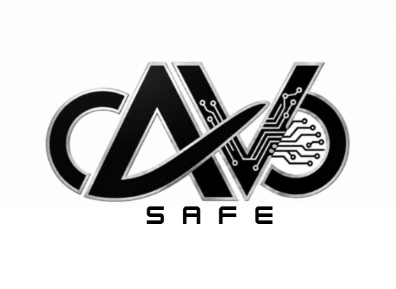
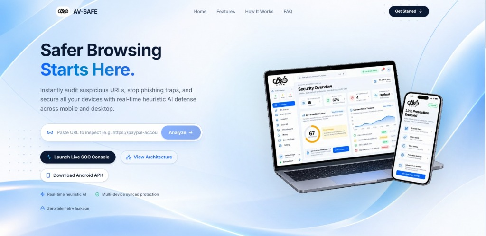
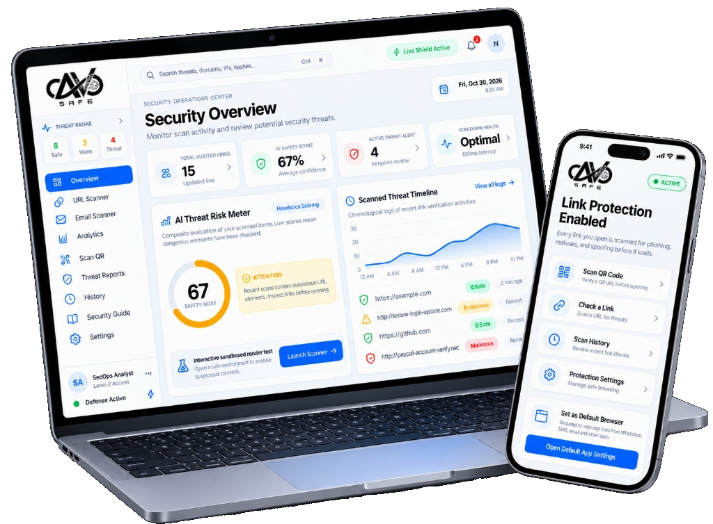
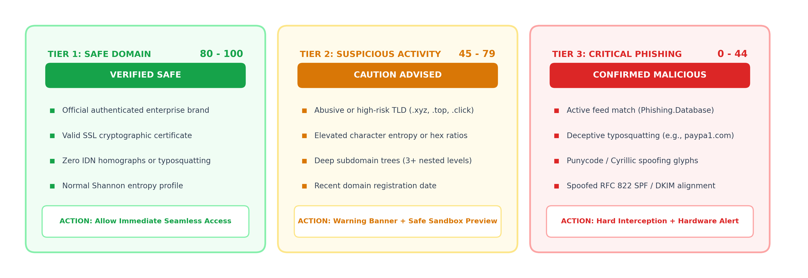
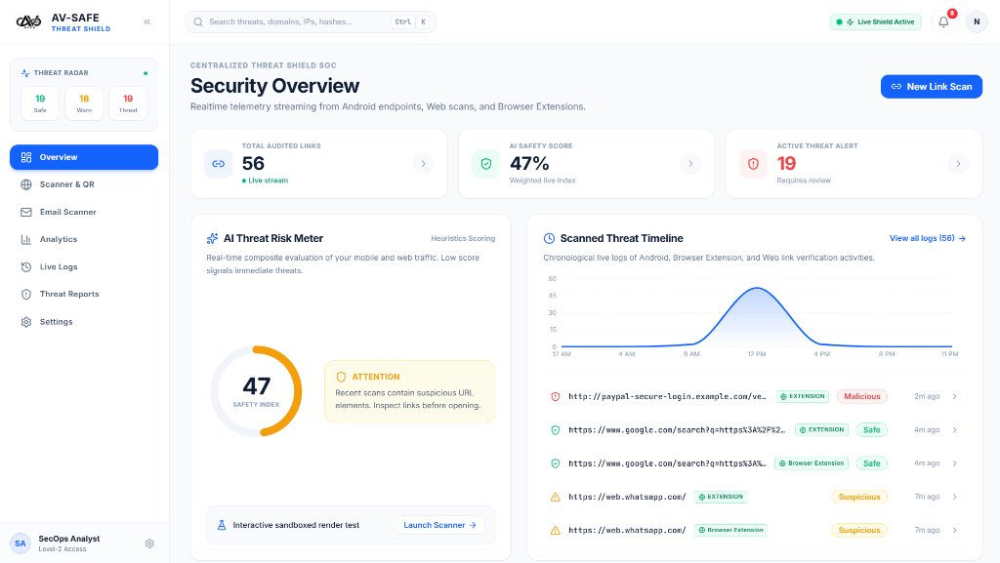
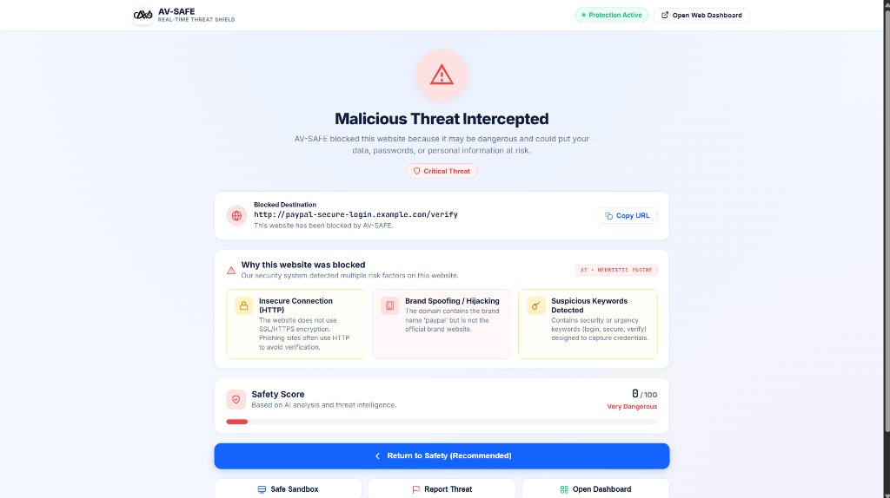
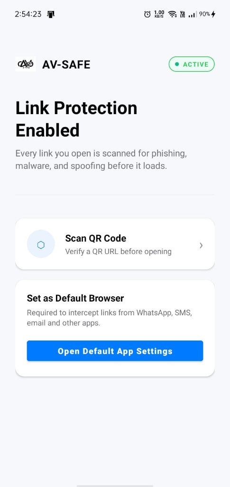
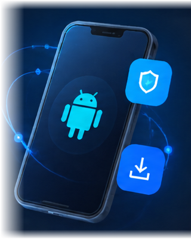

<!-- ==========================================
     AV-SAFE SEC-OPS DASHBOARD UI/UX README
     Theme: Visual-First Threat Defense System
     ========================================== -->

<div align="center" style="background-color: #F8FAFC; padding: 20px 16px; border-radius: 20px; border: 1px solid #E2E8F0; margin-bottom: 24px;">

  <!-- TOP HEADER / SEC-OPS NAV BAR -->
  <table width="100%" border="0" cellspacing="0" cellpadding="0" style="background: #FFFFFF; border-radius: 14px; border: 1px solid #E2E8F0; padding: 12px 20px; box-shadow: 0 2px 8px rgba(0,0,0,0.03);">
    <tr>
      <td align="left" valign="middle">
        <div style="display: flex; align-items: center; gap: 12px;">
          
          <span style="font-size: 20px; font-weight: 800; color: #0F172A; letter-spacing: -0.5px; vertical-align: middle;">
            AV-SAFE <span style="font-size: 13px; font-weight: 600; color: #1463FF; background: #EFF6FF; border: 1px solid #DBEAFE; padding: 3px 9px; border-radius: 9999px; margin-left: 6px;">SecOps Threat Shield v2.4</span>
          </span>
        </div>
      </td>
      <td align="right" valign="middle">
        <a href="http://localhost:3000/system" style="text-decoration: none; font-size: 12px; font-weight: 600; color: #FFFFFF; background: #1463FF; padding: 8px 14px; border-radius: 8px; margin-right: 6px;">⚡ Dashboard</a>
        <a href="http://localhost:3000" style="text-decoration: none; font-size: 12px; font-weight: 600; color: #334155; background: #F1F5F9; border: 1px solid #CBD5E1; padding: 7px 12px; border-radius: 8px; margin-right: 6px;">🌐 Scanner</a>
        <a href="#android-link-shield" style="text-decoration: none; font-size: 12px; font-weight: 600; color: #334155; background: #F1F5F9; border: 1px solid #CBD5E1; padding: 7px 12px; border-radius: 8px;">📱 Android</a>
      </td>
    </tr>
  </table>

  <br />

  <!-- HERO BANNER CARD -->
  <div style="background: #FFFFFF; border: 1px solid #E2E8F0; border-radius: 16px; overflow: hidden; box-shadow: 0 4px 20px rgba(0,0,0,0.04);">
    
    
    <div style="padding: 16px 20px; text-align: center;">
      <div style="display: flex; gap: 8px; justify-content: center; flex-wrap: wrap;">
        
        
        
        
        
        
        
      </div>
    </div>
  </div>

  <br />

  <!-- STATS & KPI METRIC CARDS -->
  <table width="100%" border="0" cellspacing="10" cellpadding="0">
    <tr>
      <td width="25%" valign="top" style="background: #FFFFFF; border: 1px solid #E2E8F0; border-radius: 14px; padding: 14px 18px; box-shadow: 0 2px 6px rgba(0,0,0,0.02); text-align: left;">
        <span style="font-size: 11px; font-weight: 700; color: #64748B; text-transform: uppercase;">Detection Speed</span>
        <div style="font-size: 24px; font-weight: 800; color: #0F172A; margin: 2px 0;">&lt; 10ms</div>
        <div style="font-size: 11px; color: #16A34A; font-weight: 600;">⚡ Zero-Latency Edge</div>
      </td>
      <td width="25%" valign="top" style="background: #FFFFFF; border: 1px solid #E2E8F0; border-radius: 14px; padding: 14px 18px; box-shadow: 0 2px 6px rgba(0,0,0,0.02); text-align: left;">
        <span style="font-size: 11px; font-weight: 700; color: #64748B; text-transform: uppercase;">ML Features</span>
        <div style="font-size: 24px; font-weight: 800; color: #1463FF; margin: 2px 0;">24 Signals</div>
        <div style="font-size: 11px; color: #64748B; font-weight: 500;">Entropy + Structure + TLD</div>
      </td>
      <td width="25%" valign="top" style="background: #FFFFFF; border: 1px solid #E2E8F0; border-radius: 14px; padding: 14px 18px; box-shadow: 0 2px 6px rgba(0,0,0,0.02); text-align: left;">
        <span style="font-size: 11px; font-weight: 700; color: #64748B; text-transform: uppercase;">Threat Feed</span>
        <div style="font-size: 24px; font-weight: 800; color: #E11D48; margin: 2px 0;">Real-Time</div>
        <div style="font-size: 11px; color: #64748B; font-weight: 500;">Phishing.Database Sync</div>
      </td>
      <td width="25%" valign="top" style="background: #FFFFFF; border: 1px solid #E2E8F0; border-radius: 14px; padding: 14px 18px; box-shadow: 0 2px 6px rgba(0,0,0,0.02); text-align: left;">
        <span style="font-size: 11px; font-weight: 700; color: #64748B; text-transform: uppercase;">Platforms</span>
        <div style="font-size: 24px; font-weight: 800; color: #7C3AED; margin: 2px 0;">3 Clients</div>
        <div style="font-size: 11px; color: #64748B; font-weight: 500;">Web • Extension • Android</div>
      </td>
    </tr>
  </table>

</div>

<!-- ==========================================
     VISUAL 1: ANIMATED SYSTEM ARCHITECTURE
     ========================================== -->

<div style="background: #FFFFFF; border: 1px solid #E2E8F0; border-radius: 18px; padding: 24px; box-shadow: 0 4px 16px rgba(0,0,0,0.03); margin-bottom: 24px;">

  <div align="center" style="margin-bottom: 16px;">
    <h2 style="margin: 0; font-size: 20px; font-weight: 800; color: #0F172A;">
      🏛️ End-to-End System Architecture (Live Animated Flow)
    </h2>
  </div>

  <div align="center" style="background: #0B1120; border: 1px solid #334155; border-radius: 16px; padding: 16px; box-shadow: 0 10px 25px -5px rgba(0,0,0,0.3);">
    
  </div>

  <br />

  <div align="center" style="background: #F8FAFC; border: 1px solid #E2E8F0; border-radius: 16px; padding: 20px;">
    
  </div>

</div>

<!-- ==========================================
     VISUAL 2: ANIMATED DETECTION PIPELINES
     ========================================== -->

<div style="background: #FFFFFF; border: 1px solid #E2E8F0; border-radius: 18px; padding: 24px; box-shadow: 0 4px 16px rgba(0,0,0,0.03); margin-bottom: 24px;">

  <div align="center" style="margin-bottom: 16px;">
    <h2 style="margin: 0; font-size: 20px; font-weight: 800; color: #0F172A;">
      🧠 Animated 6-Stage Detection Pipeline
    </h2>
  </div>

  <div align="center" style="background: #0B1120; border: 1px solid #334155; border-radius: 16px; padding: 16px; margin-bottom: 24px; box-shadow: 0 10px 25px -5px rgba(0,0,0,0.3);">
    
  </div>

  <div align="center" style="margin-bottom: 16px;" id="android-link-shield">
    <h2 style="margin: 0; font-size: 20px; font-weight: 800; color: #0F172A;">
      📱 Animated Android Intent Gatekeeper &amp; Siren Flow
    </h2>
  </div>

  <div align="center" style="background: #0B1120; border: 1px solid #334155; border-radius: 16px; padding: 16px; margin-bottom: 24px; box-shadow: 0 10px 25px -5px rgba(0,0,0,0.3);">
    
  </div>

  <div align="center" style="margin-bottom: 16px;">
    <h2 style="margin: 0; font-size: 20px; font-weight: 800; color: #0F172A;">
      ⚖️ Dynamic Threat Scoring Matrix
    </h2>
  </div>

  <div align="center" style="background: #F8FAFC; border: 1px solid #E2E8F0; border-radius: 16px; padding: 16px;">
    
  </div>

</div>

<!-- ==========================================
     VISUAL 3: LIVE SOC SECOPS DASHBOARD
     ========================================== -->

<div style="background: #FFFFFF; border: 1px solid #E2E8F0; border-radius: 18px; padding: 24px; box-shadow: 0 4px 16px rgba(0,0,0,0.03); margin-bottom: 24px;">

  <div align="center" style="margin-bottom: 16px;">
    <h2 style="margin: 0; font-size: 20px; font-weight: 800; color: #0F172A;">
      📊 Real-Time SOC SecOps Operations Dashboard
    </h2>
  </div>

  <div align="center" style="background: #F8FAFC; border: 1px solid #E2E8F0; border-radius: 16px; padding: 16px; margin-bottom: 20px;">
    
  </div>

  <div align="center" style="background: #F8FAFC; border: 1px solid #E2E8F0; border-radius: 16px; padding: 16px;">
    
  </div>

</div>

<!-- ==========================================
     VISUAL 4: CLIENT INTERCEPTION INTERFACES
     ========================================== -->

<div style="background: #FFFFFF; border: 1px solid #E2E8F0; border-radius: 18px; padding: 24px; box-shadow: 0 4px 16px rgba(0,0,0,0.03); margin-bottom: 24px;">

  <div align="center" style="margin-bottom: 16px;">
    <h2 style="margin: 0; font-size: 20px; font-weight: 800; color: #0F172A;">
      ⚡ Real-Time Edge Interception Interfaces
    </h2>
  </div>

  <table width="100%" border="0" cellspacing="16" cellpadding="0" style="margin-bottom: 20px;">
    <tr>
      <!-- Browser Extension -->
      <td width="58%" valign="middle" align="center" style="background: #FAFAFA; border: 1px solid #E2E8F0; border-radius: 14px; padding: 16px;">
        
      </td>
      <!-- Android Native Screen -->
      <td width="42%" valign="middle" align="center" style="background: #FAFAFA; border: 1px solid #E2E8F0; border-radius: 14px; padding: 16px;">
        
      </td>
    </tr>
  </table>

  <!-- MOBILE INTENT & QUISHING DEEP DIVE -->
  <table width="100%" border="0" cellspacing="16" cellpadding="0">
    <tr>
      <td width="50%" valign="middle" align="center" style="background: #FAFAFA; border: 1px solid #E2E8F0; border-radius: 14px; padding: 20px;">
        
      </td>
      <td width="50%" valign="middle" align="center" style="background: #FAFAFA; border: 1px solid #E2E8F0; border-radius: 14px; padding: 20px;">
        <div style="background: #FFFFFF; border: 1px solid #CBD5E1; border-radius: 12px; padding: 14px; display: inline-block;">
          
        </div>
      </td>
    </tr>
  </table>

</div>

<!-- ==========================================
     VISUAL 5: QUICK COMMANDS
     ========================================== -->

<div style="background: #FFFFFF; border: 1px solid #E2E8F0; border-radius: 18px; padding: 24px; box-shadow: 0 4px 16px rgba(0,0,0,0.03); margin-bottom: 24px;">

  <div align="center" style="margin-bottom: 16px;">
    <h2 style="margin: 0; font-size: 20px; font-weight: 800; color: #0F172A;">
      ⚙️ Quickstart
    </h2>
  </div>

  ```bash
  git clone https://github.com/Anmol-Malviya/AV-SAFE.git
  cd AV-SAFE
  npm install
  npm run dev
  ```

</div>

<!-- ==========================================
     VISUAL 6: FOUNDERS & ARCHITECTS
     ========================================== -->

<div style="background: #FFFFFF; border: 1px solid #E2E8F0; border-radius: 18px; padding: 28px 24px; box-shadow: 0 4px 16px rgba(0,0,0,0.03); margin-bottom: 24px;">

  <div align="center" style="margin-bottom: 24px;">
    <span style="font-size: 11px; font-weight: 800; color: #1463FF; background: #EFF6FF; border: 1px solid #DBEAFE; padding: 4px 12px; border-radius: 9999px; text-transform: uppercase;">
      🏆 FOUNDERS &amp; ARCHITECTS
    </span>
  </div>

  <table width="100%" border="0" cellspacing="14" cellpadding="0">
    <tr>
      <!-- Founder 1: Anmol Malviya -->
      <td width="33.3%" valign="top" style="background: #FAFAFA; border: 1px solid #E2E8F0; border-radius: 16px; padding: 20px; text-align: center; box-shadow: 0 2px 8px rgba(0,0,0,0.02);">
        
        <div style="font-size: 17px; font-weight: 800; color: #0F172A;">Anmol Malviya</div>
        <div style="font-size: 12px; font-weight: 700; color: #1463FF; margin-top: 2px;">Co-Founder &amp; AI / Threat Intel Lead</div>
      </td>

      <!-- Founder 2: Tanay Agrawal -->
      <td width="33.3%" valign="top" style="background: #FAFAFA; border: 1px solid #E2E8F0; border-radius: 16px; padding: 20px; text-align: center; box-shadow: 0 2px 8px rgba(0,0,0,0.02);">
        
        <div style="font-size: 17px; font-weight: 800; color: #0F172A;">Tanay Agrawal</div>
        <div style="font-size: 12px; font-weight: 700; color: #6366F1; margin-top: 2px;">Co-Founder &amp; Full-Stack Systems Lead</div>
      </td>

      <!-- Founder 3: Hritik Jaishwal -->
      <td width="33.3%" valign="top" style="background: #FAFAFA; border: 1px solid #E2E8F0; border-radius: 16px; padding: 20px; text-align: center; box-shadow: 0 2px 8px rgba(0,0,0,0.02);">
        
        <div style="font-size: 17px; font-weight: 800; color: #0F172A;">Hritik Jaishwal</div>
        <div style="font-size: 12px; font-weight: 700; color: #10B981; margin-top: 2px;">Co-Founder &amp; Security / Mobile Lead</div>
      </td>
    </tr>
  </table>

</div>

<!-- ==========================================
     FOOTER
     ========================================== -->

<div align="center" style="padding: 20px; color: #64748B; font-size: 12px;">
  <p style="margin: 0; font-weight: 600; color: #0F172A;">
    © AV-SAFE Security Ecosystem. MIT Licensed.
  </p>
</div>
