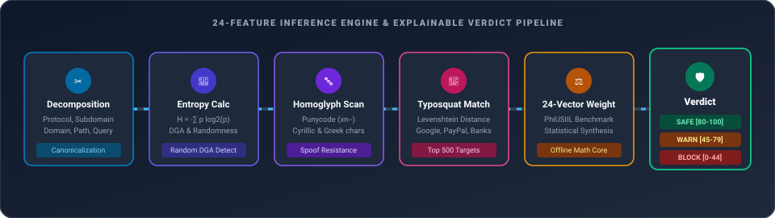
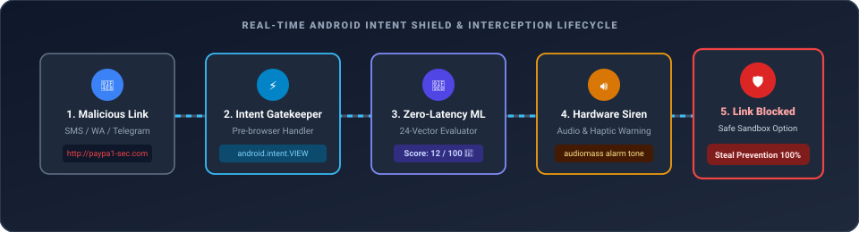

<!-- ==========================================
     AV-SAFE SEC-OPS DASHBOARD UI/UX README
     Theme: Visual-First Threat Defense System
     ========================================== -->

<div align="center">

# AV-SAFE Threat Shield v2.4
### Zero-Latency Multi-Platform Cybersecurity & Real-Time Phishing Threat Defense

[](https://nextjs.org/)
[](https://react.dev/)
[](https://tailwindcss.com/)
[](https://mongodb.com/)
[](./extansion)
[](./android-app)

<br/>


<br/><br/>

| Detection Speed | ML Features | Threat Feed | Platforms |
| :---: | :---: | :---: | :---: |
| **< 10ms** <br/> ⚡ *Zero-Latency Edge* | **24 Signals** <br/> 🧠 *PhiUSIIL Matrix* | **Real-Time** <br/> 🛡️ *Phishing.Database* | **3 Clients** <br/> 🌐 *Web • Ext • Android* |

<br/>

## 🏛️ End-to-End System Architecture (Live Animated Flow)



<br/><br/>


<br/>

## 🧠 Animated 6-Stage Detection Pipeline



<br/>

## 📱 Animated Android Intent Gatekeeper & Siren Flow



<br/>

## ⚖️ Dynamic Threat Scoring Matrix


<br/>

## 📊 Real-Time SOC SecOps Operations Dashboard


<br/><br/>


<br/>

## ⚡ Real-Time Edge Interception Interfaces

| Chromium Extension Threat Guard | Android Link Shield |
| :---: | :---: |
|  |  |

<br/>

| Android Intent Gatekeeper Trap | Privacy-First Quishing (QR) Scanner |
| :---: | :---: |
|  |  |

<br/>

## ⚙️ Quickstart

</div>

```bash
# 1. Clone repository
git clone https://github.com/Anmol-Malviya/AV-SAFE.git
cd AV-SAFE

# 2. Install dependencies & launch
npm install
npm run dev
```

<div align="center">

<br/>

## 🏆 FOUNDERS & ARCHITECTS

|  |  |  |
| :---: | :---: | :---: |
| **Anmol Malviya** | **Tanay Agrawal** | **Hritik Jaishwal** |
| Co-Founder & AI / Threat Intel Lead | Co-Founder & Full-Stack Systems Lead | Co-Founder & Security / Mobile Lead |

<br/>

---

© AV-SAFE Security Ecosystem • MIT Licensed

</div>
