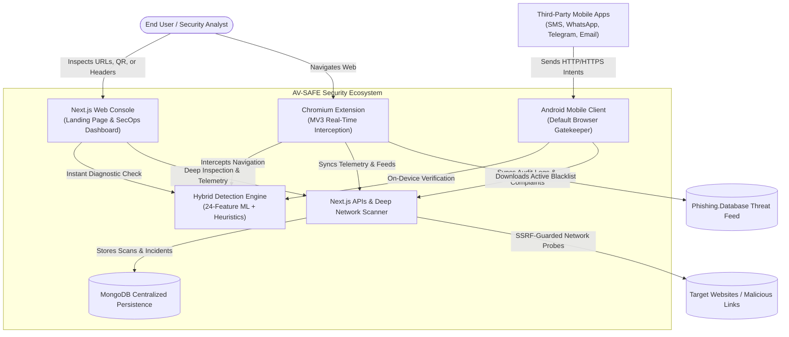

<div align="center">
  

  # 🛡️ AV-SAFE (Phish-Guard)

  **Next-Generation Multi-Platform Cybersecurity & Real-Time Phishing Threat Defense Ecosystem**

  [](https://nextjs.org/)
  [](https://react.dev/)
  [](https://tailwindcss.com/)
  [](https://www.mongodb.com/)
  [](https://developer.chrome.com/docs/extensions/mv3/)
  [](https://developer.android.com/)
  [](./LICENSE)

  <br />

  **[Web Dashboard](http://localhost:3000/system)** • **[Live Scanner](http://localhost:3000)** • **[Browser Extension](./extansion)** • **[Android App](./android-app)** • **[Architecture Guide](./ARCHITECTURE.md)**
</div>

---

## 📌 Executive Overview

**AV-SAFE** (internally designated **SecureOS Threat Shield / Phish-Guard**) is an explainable, multi-platform cybersecurity platform engineered to detect, intercept, analyze, and mitigate phishing threats and malicious web infrastructure in real time.

Unlike black-box scanners that emit opaque risk scores without justification, AV-SAFE couples a **transparent Machine Learning classifier** (trained on 24 structural, statistical, and linguistic URL features derived from the benchmark PhiUSIIL dataset) with a **deterministic Heuristic Security Layer** (covering homograph attacks, typosquatting, brand spoofing, entropy metrics, and TLD abuse).

The ecosystem delivers **zero-latency edge enforcement** and **defense-in-depth** across three dedicated client environments:
1. **SecOps Web Platform**: A Next.js 16 + React 19 analytics and diagnostic dashboard.
2. **Chromium Browser Extension (Manifest V3)**: Real-time navigation interceptor with light-theme threat warning page and isolated preview sandbox.
3. **Android Native Client**: Mobile browser intent gatekeeper with hardware sound warning and centralized MongoDB telemetry synchronization.

---

## 🏗️ Multi-Platform Ecosystem



---

## 🚀 Key Features

### 1. 🔍 Comprehensive URL Threat Inspection
* **Structural Analytics**: Protocol security (HTTPS vs HTTP), raw IPv4/IPv6 address detection, URL/path/domain length, subdomain hierarchy counts.
* **Linguistic & Statistical Vectors**: Shannon entropy calculation, sensitive authentication keyword extraction, character ratios (digit/letter/special symbol distribution).
* **Infrastructure Checks**: Suspicious and high-abuse Top-Level Domains (TLDs) and URL shortener payload unfolding.

### 2. 🏢 Brand Protection & Typosquatting Defense
* **Trusted Brand Whitelist**: Instant verification for official, verified enterprise domains.
* **Brand Impersonation Detection**: Identifies trusted brand names hidden within unauthorized subdomains or paths.
* **Typosquatting Engine**: Uses normalized Levenshtein edit distance algorithms to flag visually deceptive domains (e.g., `paypa1.com`, `gooogle.com`).

### 3. 🌐 IDN Homograph & Punycode Defense
* **Punycode Deobfuscation**: Flags domains attempting to disguise malicious Unicode as legitimate text (`xn--...`).
* **Mixed-Script Analysis**: Detects look-alike Cyrillic and Greek glyphs masquerading as standard Latin characters.

### 4. 🧩 Chromium Browser Extension (Manifest V3)
* **Real-Time Navigation Guard**: Automatically intercepts high-risk links before the browser connects.
* **Light-Theme Warning Page**: Modern, responsive threat interception interface displaying exact detection reasons, safety meter, and actionable telemetry.
* **Safe Sandbox Preview**: Launches suspicious URLs in an isolated, script-disabled sandbox environment (`extansion/sandbox.html`).
* **Active Threat Intel Sync**: Synchronizes with Phishing.Database active domain feeds for instant 0ms offline blocking.
* **Multi-Tab Popup**: Features current tab analysis, deep cloud scanner, live activity feed, and custom URL tester.

### 5. 📱 Android Mobile Protection Client
* **System-Wide Intent Gatekeeper**: Intercepts link clicks from SMS, WhatsApp, Gmail, and third-party messaging apps.
* **Hardware Warning Feedback**: Triggers real-time audio alerts (`warning_sound.mp3`) and visual hazard banners when intercepting phishing targets.
* **Offline On-Device Port**: Kotlin implementation of the 24-feature ML model and heuristics running directly in Android ART.
* **SecOps Complaint Filing**: Enables mobile users to file incident tickets directly into the central MongoDB database.

### 6. 📧 Email Header Security Parser
* Parses raw RFC 822 email headers to evaluate **SPF**, **DKIM**, and **DMARC** authentication alignments.
* Flags `From:` and `Return-Path:` spoofing discrepancies and urgency keyword manipulation.

### 7. 📷 Quishing (QR Code Phishing) Scanner
* Client-side video stream integration powered by `html5-qrcode`.
* Decodes physical QR codes or uploaded images directly in the browser without sending images to external servers (Privacy-First).

### 8. 📊 SecOps Central Operations Console
* **Scanned Threat Timeline**: Interactive 24-hour volume AreaChart tracking safe checks vs malicious interceptions.
* **Centralized Source Split**: Telemetry distribution categorized across Android App, Browser Extension, and Web Dashboard.
* **Neural Weightings Monitor**: Real-time inspection of the active logistic model coefficients and SHA-256 weight signatures.
* **Geographical Threat Vectors & Targeted Brands**: Horizontal distribution bar charts powered by Recharts.

---


---

## 📸 Platform Interface Showcase

### 1. Centralized Threat Shield SOC Console (Main Dashboard UI)
> **The central operations hub for real-time threat telemetry:**
> Aggregates synchronized live audit streams from Android endpoints, Browser Extensions, and Web Scanner inputs. Features the AI Threat Risk Meter circular gauge, live 24-hour scan volume timeline (Recharts), active threat alerts, and instant link verification.

<div align="center">
  
  <p align="center"><em>Centralized Threat Shield SOC Console — Security Overview, AI Threat Risk Meter (47/100 Attention Index), 24h Scanned Threat Timeline, and real-time multi-platform audit log stream.</em></p>
</div>

<br />

### 2. Browser Extension: Real-Time Threat Interception Shield
> **What appears when you click a suspicious or malicious link:**
> When the AV-SAFE Browser Extension detects a malicious or deceptive website, it immediately halts navigation before any network payload or phishing login form can execute, displaying this full-screen threat defense interface.

<div align="center">
  
  <p align="center"><em>Active Threat Interception Shield — Displays the blocked destination, AI heuristic risk breakdown (Insecure HTTP, Brand Spoofing, Suspicious Keywords), Safety Score meter, and Safe Sandbox options.</em></p>
</div>

<br />

### 3. Multi-Device Unified Protection (Mobile & Desktop)
<div align="center">
  
  <p align="center"><em>Synchronized Security Across Desktop SOC & Android Mobile Link Protection Client</em></p>
</div>

## 🧠 Detection Engine Pipeline

The detection engine processes URLs through a transparent, deterministic multi-stage pipeline:

```
                      [ Incoming URL Input ]
                                │
                                ▼
               [ 24-Feature Vector Extraction ]
        (Lengths, Ratios, Entropies, Ratios, Counts, TLD)
                                │
                                ▼
               [ Z-Score Feature Normalization ]
                 x_std = (x - mean) / std
                                │
                                ▼
              [ Logistic Regression Inference ]
               z = bias + Σ (weight_i * x_std_i)
                 p_ml = 1 / (1 + e^(-z))
                                │
                                ▼
                [ Heuristic Security Engine ]
     (Homographs, Typosquatting, Brand Spoofing, Blacklists)
                                │
                                ▼
                 [ Dynamic Risk Calibration ]
          Combined Risk Score (0-100) & Explanations
                                │
                                ▼
           [ SAFE (80-100) | SUSPICIOUS (45-79) | DANGEROUS (0-44) ]
```

The core mathematical parameters are stored in [**`src/lib/phishing_model_weights.json`**](file:///c:/Users/gamin/OneDrive/Desktop/AV-SAFE/src/lib/phishing_model_weights.json) and executed locally across all platforms without external latency.

### Risk Score Matrix

| Safety Score | Risk Rating | Classification Details |
| :---: | :---: | :--- |
| **80 – 100** | `SAFE` | Verified domain structures, valid SSL, zero heuristic anomalies. |
| **45 – 79** | `SUSPICIOUS` | Minor warnings triggered (e.g., suspicious TLD, recent domain, non-standard path). Caution advised. |
| **0 – 44** | `DANGEROUS` | Confirmed attack vectors, typosquatting, IDN homographs, brand spoofing, or blacklist match. |

---

## 🛠️ Technology Stack

### Web SecOps Platform
* **Framework**: Next.js 16.2.10 (App Router, Turbopack, React 19.2.4)
* **Styling**: Tailwind CSS v4, PostCSS
* **Visualizations**: Recharts 3.9.2
* **Animations**: Framer Motion 12.42.2
* **Icons**: Lucide React
* **QR Processing**: HTML5-QRCode 2.3.8
* **Database**: MongoDB with Mongoose 9.7.3

### Browser Extension
* **Architecture**: Chromium Manifest V3 (Google Chrome, Microsoft Edge, Brave)
* **Runtime**: Native ES Modules, Vanilla HTML5 & CSS3
* **Background**: Service Worker with `declarativeNetRequest` and `storage.local` caching
* **Security**: Client-side offline inference (<10ms execution)

### Android Native Client
* **Language**: Kotlin Native (Android 8.0+ / API 26+)
* **Architecture**: Jetpack Navigation, Intent Filters (`android.intent.action.VIEW`), WebViews
* **Networking**: Retrofit2 / OkHttp with Coroutines

---

## ⚙️ Installation & Setup

### Prerequisites
* **Node.js**: v18.18+ or v20+ (v24 tested and compatible)
* **npm** or **pnpm**
* **MongoDB**: A running local MongoDB instance or a [MongoDB Atlas](https://www.mongodb.com/cloud/atlas) connection URI

### 1. Clone the Repository
```bash
git clone https://github.com/Anmol-Malviya/AV-SAFE.git
cd AV-SAFE
```

### 2. Install Dependencies
```bash
npm install
```

### 3. Configure Environment Variables
Create a `.env.local` file in the root directory:
```env
# MongoDB Connection String
MONGODB_URI=mongodb://localhost:27017/av-safe
# Alternatively, use MongoDB Atlas:
# MONGODB_URI=mongodb+srv://<user>:<password>@cluster.mongodb.net/av-safe?retryWrites=true&w=majority

# Next.js Server Port (Default: 3000)
PORT=3000
```

### 4. Run Development Server
```bash
npm run dev
```
Open [http://localhost:3000](http://localhost:3000) in your browser to view the Landing Page, or [http://localhost:3000/system](http://localhost:3000/system) to access the SecOps Console.

### 5. Production Build & Linting
```bash
# Run ESLint validation
npm run lint

# Build optimized production bundle
npm run build

# Start production server
npm run start
```

---

## 🔌 Installing the Browser Extension

1. Open **Google Chrome** (or any Chromium browser).
2. Navigate to `chrome://extensions/`.
3. Toggle on **Developer mode** in the upper-right corner.
4. Click **Load unpacked**.
5. Select the `extansion` directory inside the repository.
6. The **AV-SAFE Threat Shield** icon will appear in your browser toolbar.

---

## 📱 Setting up the Android Client

1. Open the `android-app` directory in **Android Studio Hedgehog / Iguana / Ladybug**.
2. Sync Gradle dependencies.
3. Configure your local backend IP in `AppSyncManager.kt` (e.g., `http://10.0.2.2:3000` for Android Emulator or your LAN IP for a physical device).
4. Run on a virtual device or connected smartphone.
5. Set AV-SAFE as the default browser handler to intercept inbound links.

---

## 🛡️ Security & Privacy Guarantees

* **Zero-Telemetry Local Scoring**: Core URL classification is computed 100% on-device. URL parameters are not shipped to external third parties.
* **Anti-SSRF Protected Probes**: Server-side deep scans enforce strict IP validation, blocking RFC 1918 private ranges (`127.0.0.1`, `10.0.0.0/8`, `192.168.0.0/16`, cloud metadata `169.254.169.254`).
* **Strict DOM Sandboxing**: The extension's Safe Sandbox isolates external previews in sandboxed frames, disabling scripts and forms.

---

## 🤝 Contributing

Contributions are welcome! To get started:

1. Fork the repository.
2. Create your feature branch (`git checkout -b feature/threat-feed-enhancement`).
3. Commit your changes (`git commit -m "feat: add novel punycode heuristic"`).
4. Ensure code cleanliness (`npm run lint && npm run build`).
5. Push to the branch (`git push origin feature/threat-feed-enhancement`).
6. Open a Pull Request.

---

## 📄 License

This project is licensed under the MIT License — see the [LICENSE](./LICENSE) file for details.

<div align="center">
  <sub>Engineered with precision for explainable, trustworthy threat defense. © AV-SAFE Security.</sub>
</div>
