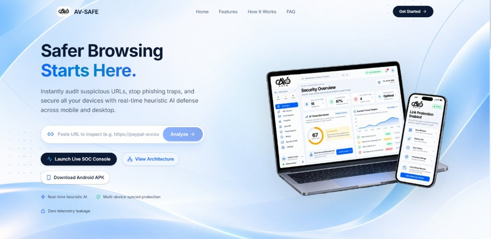

<!-- AV-SAFE — Advanced Phishing Detection System — Minor Project README -->

<div align="center">

<br/>

# AV-SAFE
### Advanced Phishing Detection System

**Minor Project — B.Tech CSE | 2026**

<br/>

[](https://nextjs.org/)
[](https://react.dev/)
[](https://tailwindcss.com/)
[](https://mongodb.com/)
[](./apps/extension)
[](./apps/android)
[](./ml)
[](./LICENSE)

<br/>



<br/><br/>

</div>

---

## About the Project

**AV-SAFE** is an enterprise-grade, cross-platform, real-time phishing detection and prevention platform. It combines a machine learning model trained on **235,795 real phishing and legitimate URLs** with deterministic heuristic rules and client-side inference engines embedded natively across a modern Web application, a Chromium extension, and an Android mobile application.

No external cloud API calls are required for real-time edge classification. The ML model runs fully offline, achieving **< 10 ms detection latency**.

---

## Key Features

- **Multi-Platform Edge Protection**:
  - **Web Platform (PWA)**: Next.js 16 App Router interface for URL scanning, QR code inspection, and SecOps triage.
  - **Chromium MV3 Extension**: Intercepts web navigation in real time before page rendering.
  - **Native Android Interceptor**: Deep-link intent gatekeeper with on-device safety scoring and threat sandboxing.
- **Offline ML Inference Engine**: Zero-dependency linear arithmetic evaluator running identical 24-feature models in JavaScript and Kotlin.
- **Deep Network Inspection**: Server-side asynchronous DNS resolution, TLS certificate validation, and anti-SSRF DOM inspection.
- **Incident Reporting & SecOps Triage**: Idempotent threat logging, IP rate limiting, and administrative review workflows backed by MongoDB Atlas.

---

## System Architecture

<div align="center">


<br/><br/>


</div>

---

## Repository Structure

```text
AV-SAFE/
├── apps/
│   ├── web/                 # Next.js web application documentation and references
│   ├── android/             # Native Android Kotlin application (com.phishguard)
│   └── extension/           # Chromium Manifest V3 browser security extension
│
├── backend/
│   ├── api/                 # API route definitions and endpoint reference
│   ├── models/              # Mongoose data models (Complaint, UrlScan)
│   ├── services/            # Core business logic (phishingEngine)
│   ├── middleware/          # Security controls (anti-SSRF, rate limiting, admin auth)
│   ├── validators/          # Payload validation logic
│   └── config/              # MongoDB connection pool management
│
├── ml/
│   ├── models/              # Trained models (LightGBM, XGBoost, Random Forest, SGD)
│   ├── weights/             # Production inference weights (phishing_model_weights.json)
│   ├── training/            # Training scripts and hyperparameter tuning
│   ├── datasets/            # Dataset pipelines, loaders, and splits
│   ├── inference/           # Feature extractors and evaluation modules
│   ├── utils/               # Logger, config loader, reproducibility utils
│   ├── config/              # training_config.yaml, feature_config.yaml
│   └── tests/               # Pytest test suite for ML pipelines
│
├── scripts/                 # Automation utilities (weights sync, icon generator, build helpers)
├── docs/                    # Technical documentation
│   ├── architecture/        # High-level architecture and C4 diagrams
│   ├── api/                 # REST API specification and schema documentation
│   ├── development/         # Local developer environment setup
│   ├── deployment/          # Production deployment runbooks
│   └── ml/                  # Model training reports and evaluations
│
├── assets/                  # Shared media, diagrams, branding, and screenshots
│   ├── diagrams/            # Architecture diagrams (SVG)
│   ├── branding/            # Founder portraits and visual brand identity
│   └── screenshots/         # Dashboard previews
│
├── config/                  # Shared project configuration
├── src/                     # Next.js App Router application
│   ├── app/                 # UI pages, tabs, and route handlers
│   └── lib/                 # Modular re-export bridges to @backend/* and @ml/*
│
├── .env.example             # Template environment configuration
├── .gitignore               # Strict exclusion rules for builds, caches, and datasets
├── README.md                # Project documentation root
├── jsconfig.json            # Path alias configuration (@/*, @backend/*, @ml/*)
└── package.json             # Root Next.js and frontend workspace configuration
```

---

## Technology Stack

| Architectural Layer | Technology |
| :--- | :--- |
| **Frontend Platform** | Next.js 16 (Turbopack), React 19, Tailwind CSS v4, Framer Motion |
| **Backend & API** | Next.js Server Route Handlers, Node.js (Async DNS/TLS sockets), Mongoose 9 |
| **Database** | MongoDB Atlas / Local MongoDB with connection caching |
| **Mobile Application** | Native Android (Kotlin), Intent Gatekeeper, Android ART Runtime |
| **Browser Extension** | Chromium Manifest V3 (Chrome, Brave, Edge), Service Worker |
| **Machine Learning** | Python 3.12, Scikit-learn, XGBoost, LightGBM, Pandas, PyArrow |
| **Offline Inference** | Standardized 24-feature linear model (< 10 ms execution in JS & Kotlin) |

---

## Getting Started

### 1. Environment Setup

Copy `.env.example` to `.env.local`:
```bash
cp .env.example .env.local
```
Fill in your MongoDB connection string and secret keys.

### 2. Web Application & Backend

```bash
# Install dependencies
npm install

# Run development server
npm run dev

# Run linting and production build
npm run lint
npm run build
```

The web dashboard is accessible at `http://localhost:3000`.

### 3. Machine Learning Pipeline

```bash
cd ml

# Create virtual environment with uv
uv venv .venv --python python3
source .venv/bin/activate

# Install requirements
uv pip install -r requirements.txt pytest pyyaml

# Run ML unit tests
pytest -q tests

# Run training or model evaluation
python train.py
python evaluate.py
```

### 4. Chromium Extension

1. Open `chrome://extensions/` in Chrome or Brave.
2. Enable **Developer mode**.
3. Click **Load unpacked** and select `apps/extension/`.

### 5. Native Android Application

```bash
# Build debug APK
cd apps/android
./gradlew assembleDebug

# Windows automated script
scripts\build-apk.bat
```

---

## Documentation Links

- [System Architecture](docs/architecture/ARCHITECTURE.md)
- [Backend & API Specification](docs/api/BACKEND_SPECIFICATION.md)
- [Development Setup](docs/development/DEVELOPMENT.md)
- [Deployment Guide](docs/deployment/DEPLOYMENT.md)
- [ML Training Report](docs/ml/reports/MODEL_TRAINING_REPORT.md)

---

## Team

<div align="center">

|  |  |  |
| :---: | :---: | :---: |
| **Anmol Malviya** | **Tanay Agrawal** | **Hritik Jaiswal** |
| AI / Threat Intelligence Lead | Full-Stack Systems Lead | Security / Mobile Lead |

<br/>

---

© 2026 AV-SAFE Security Ecosystem — MIT Licensed

</div>
